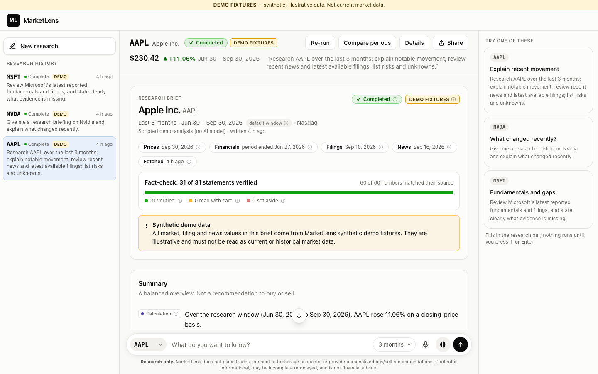
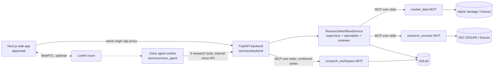

# MarketLens — AI Market Research Analyst

MarketLens researches one US-listed company (NYSE/Nasdaq) at a time and writes a brief you can verify. It combines market data, SEC company facts and filings, and dated news. Three specialist agents, a supervisor and an evidence reviewer turn that evidence into claims, and every claim cites the evidence behind it. All data access goes through three real MCP servers. Voice (LiveKit) is optional.

**Research only:** MarketLens does not place trades, connect to brokerage accounts, or give personalized buy/sell recommendations. The default demo runs on **synthetic fixture data**, which is labeled as such everywhere and is never current market data.

> **Status:** all seven build phases have passed their gates (see [`PROJECT_STATUS.md`](PROJECT_STATUS.md) for real test results, decisions and limitations). On the development machine, live data (Alpha Vantage + SEC EDGAR, with Yahoo Finance headlines for news), a free local model (Ollama) and spoken voice sessions with Lens (LiveKit Cloud) have all run end to end. OpenAI's hosted API has **not been run** (no key).



## Quickstart (no credentials, about 5 minutes)

Prerequisites: [Node.js](https://nodejs.org) ≥ 20.9, [pnpm](https://pnpm.io/installation) 12 (the version pinned in `package.json`; `corepack enable` provides it) and [uv](https://docs.astral.sh/uv/getting-started/installation/). uv installs Python 3.13 itself (pinned in `.python-version`). Developed and tested on macOS (arm64).

```bash
git clone <this repository> marketlens && cd marketlens
pnpm install                              # web app (Next.js 16, pnpm workspace)
uv sync                                   # Python: core, backend and the three MCP servers (one uv workspace)
uv run python scripts/seed_demo.py        # optional: demo research runs for the history (plus API-only saved-brief and watchlist data)
uv run python scripts/dev.py              # backend :8000 + web :3000 (also: pnpm dev); Ctrl+C stops everything
```

Open <http://localhost:3000>, type **AAPL** (or a company name such as "apple") in the ticker field of the research bar at the bottom, pick it from the dropdown (or a card under **Try one of these**), and press the **↑** button (or Enter). No `.env` file is needed: the defaults are the offline demo (fixture data, deterministic fixture LLM, voice disabled). If ports 3000/8000 are taken, use `scripts/dev.py --api-port 8001 --web-port 3001`.

A guided five-minute walkthrough is in [`docs/DEMO_SCRIPT.md`](docs/DEMO_SCRIPT.md). New to the project? [`docs/FEATURES.md`](docs/FEATURES.md) explains it in plain words and lists every feature with how to try it.

## What it does

- **One-screen, chat-style workspace:** research history on the left, the brief in the middle, quick starts (**Try one of these**) on the right, and the research bar docked at the bottom like a chat composer, on one line: a ticker dropdown (always listing the company on screen, recent tickers and the largest companies, and searchable by ticker or company name), the question, the time window, a microphone for dictation, a sound-wave button for a voice session, and a send button, like ChatGPT's composer. The bar, the history and each brief's summary bar stay on screen while the brief scrolls, and a floating ↓ button jumps to the end of a long brief. Run details and period comparison open as dialogs, so nothing navigates away, and the address bar keeps the open run (`/?run=…`) for refresh and sharing.
- **Cited research briefs:** key numbers, price movement with a chart, financial results, filings, dated news, positive and negative evidence, risks, interpretation, conditional scenarios, and the summary at the end (D-91). Dates and values read naturally ("Jun 30 – Sep 30, 2026"). Every claim links to its source, and a source panel beside the brief describes the values, the calculation and its inputs in plain words. A **Share** menu and per-section **Copy / Share** buttons hand the brief on as readable text.
- **Honest limits, in plain language:** anything that affected a report (a provider limit, a data gap, a statement the fact-checker set aside) appears in a "Heads up" card that says what happened and what you can do. A fact-check meter shows how many statements were verified, and what the brief couldn't establish is listed, never papered over. Inside the brief, every badge (Partial, LIVE DATA, Calculation, a freshness chip…) has a small ⓘ and shows its definition on hover. Every source chip has its own name (Price change, Largest daily drop, Revenue growth (quarter), 10-Q filing · Jul 31…), and the source panel describes values in plain words; no internal IDs, field names or code-style formulas are shown, and statements are cleaned of internal references before they are stored.
- **Real MCP integration:** three independently runnable MCP servers (stdio) behind an allowlisting client gateway.
- **Confirmed writes only (API):** saving a brief or changing the watchlist needs a confirmation that issues a one-time, session-bound grant. Model output can never authorize a write. The web app no longer offers these writes (D-81); the API and the workspace MCP server still enforce the rule.
- **Workspace:** re-run research, compare two periods, per-section "as of" labels, local usage analytics.
- **Dictation:** the microphone in the research bar turns speech into text in the question box with the browser's built-in speech recognition (Chrome, Edge, Safari). Nothing is spoken back, and no setup is needed.
- **PDF, copy and share:** a **PDF** button at the top right of a run saves the brief as a PDF through the browser's "Save as PDF" (a print layout with only the brief, always in light colours, folded sections opened, named like "MarketLens - AAPL research - Oct 12, 2026"); each answer section (positive, negative, risks, interpretation, scenarios, Summary) has its own **Copy** and **Share**. Copied text is readable prose with no internal IDs (D-91).
- **Quick guide:** **Explore MarketLens** (bottom right on wide screens, **✦ Explore** in the header on narrower ones) opens a guide to every feature, grouped by what you want to do, with the on-screen names of buttons and keys (D-92).
- **Optional voice session with Lens:** the sound-wave button opens a large voice screen for a two-way conversation with **Lens**, the MarketLens voice research assistant (LiveKit). The conversation keeps scrolled to the newest line, ✕ ends the session (the only stop control), and research Lens starts appears in the research history right away with a **Voice** tag: speak a question; while it researches, the screen shows the run's progress; when the answer is ready the screen shrinks to a bar, the full cited brief is on screen and the assistant speaks a short, partial-aware summary. If the browser blocks audio, a "Turn on the assistant's voice" button appears.

## Architecture at a glance



| MCP server | Tools |
|---|---|
| `market_data` | `get_quote`, `get_historical_prices`, `calculate_price_change`, `get_financial_metrics`, `get_provider_status` |
| `research_sources` | `resolve_symbol`, `search_symbols`, `get_sec_company_facts`, `search_company_filings`, `get_filing_excerpt`, `search_company_news`, `get_research_sources_status` |
| `research_workspace` | `list_watchlist`, `list_saved_briefs`, `get_saved_brief`, `create_pending_action`, and the grant-gated writes `save_research_brief`, `add_watchlist_symbol`, `remove_watchlist_symbol` |

Tool contracts are in [`MCP_TOOLS.md`](MCP_TOOLS.md), and agent and voice design is in [`VOICE_AND_AGENTS.md`](VOICE_AND_AGENTS.md). [`architecture.md`](architecture.md) describes the system as built:
- repository layout and every HTTP route;
- the nine recorded run steps;
- MCP gateway rules, database tables, the voice path and test suites;
- a table of where the build differs from the original plan, with the reason for each change.

### How a research run works

1. **Plan** (research supervisor, deterministic): evidence categories, window, budgets.
2. **Collect** evidence through allowlisted MCP tools; compute price moves, ranges and period comparisons in decimal arithmetic (on a NYSE trading calendar); detect contradictions between sources.
3. **Specialists** (market data, news & events, fundamentals) each get their own system prompt and evidence package, run concurrently (bounded), and return typed drafts. They have no tools. Third-party text reaches them only as labeled untrusted data; text flagged as instruction-like is withheld entirely.
4. **Validate** every draft deterministically: evidence IDs exist, claim type matches evidence kind, every number and date appears in the cited evidence, no unhedged causal wording, no quarterly-vs-annual comparisons, no advice or instruction-like text.
5. **Supervisor synthesis** drafts the summary, positive/negative evidence, interpretation and conditional scenarios from *validated* findings only.
6. **Evidence & risk reviewer** returns a verdict per claim; combined with the deterministic checks, the stricter outcome wins. Failing claims are withheld and listed with the reason.
7. **Finalize:** `completed` only if all mandatory evidence is present, every model step and the review completed, and no material contradiction, stale market data or coverage gap remains; otherwise `partial` with the reasons shown.

A failed or slow model step never produces invented content. The step falls back to a clearly labeled deterministic summary and the report is marked `partial`. In the default demo, a deterministic **fixture LLM** stands in for the model, so the same pipeline runs offline.

### Workspace features

- **Saved briefs and the watchlist (API only):** the web app no longer shows them (D-81). The backend still serves them (`/api/briefs`, `/api/watchlist`, confirmed through `/api/actions`). Saved briefs are snapshots that keep the original evidence, as-of dates and data mode across restarts. Watchlist changes validate the symbol and are idempotent.
- **Re-run research** starts a new linked run with the same parameters; the original run and any saved brief are unchanged. A default window stays the default; an explicit window is reused exactly.
- **Compare two periods** computes the closing-price change for two date ranges with the market-data MCP server's deterministic calculator. It shows the first and last trading days actually used and the difference in percentage points.
- **As-of labels** on every section separate what the data describes (trading date, fiscal period end, filing date, publication time) from when it was retrieved, with a fresh/stale marker.
- **Latest figures only (D-85):** financial results come from the company's newest reporting period. Values filed under accounting labels the company no longer uses are dropped, and figures older than SEC filing deadlines allow (a newer report should exist) are not shown at all. "Latest" follows the filing calendar: in October, a company whose fiscal Q3 ended in March reports its next quarter only in the coming 10-Q, so March is still current.
- **Local usage analytics** (`GET /api/analytics/summary`; the Data status dialog that showed them was removed in D-81): counts and rates only (runs, completion/partial rates, saves, watchlist changes, voice connection outcomes, source-category outcomes), stored in the local database. No personal data, tickers, free text, secrets, transcripts or audio.

## Configuration

Everything is configured with environment variables or a git-ignored `.env` (`cp .env.example .env`); [`.env.example`](.env.example) documents every variable, and a test keeps it in sync with the configuration parser. Invalid combinations stop startup with an actionable message. Health and status endpoints report which capabilities are configured, never secret values.

| Mode | Values | Default |
|---|---|---|
| `APP_MODE` | `demo` (guaranteed offline: requires fixtures + fixture LLM) · `live` | `demo` |
| `DATA_MODE` | `fixtures` · `live` (Alpha Vantage + SEC EDGAR) | `fixtures` |
| `LLM_MODE` | `fixture` (deterministic, offline) · `openai` | `fixture` |
| `VOICE_MODE` | `disabled` · `livekit` | `disabled` |

**Live market data** (`APP_MODE=live`, `DATA_MODE=live`):
- `ALPHA_VANTAGE_API_KEY`: a free key allows 25 requests a day and about one per second. A research run usually needs three (quote, daily prices, news), more when the provider's fundamentals are used as a fallback. Results are cached, so re-runs need fewer.
- `SEC_USER_AGENT`: the SEC fair-access policy requires a real contact, e.g. `MarketLens/0.1 contact=you@yourdomain.com`.
- Plan-dependent endpoints that are unavailable (premium adjusted prices) are shown as unavailable; fixtures are never substituted. News, which is premium on Alpha Vantage, falls back to Yahoo Finance's public headline feed (see Data providers).

**Real LLM** (`APP_MODE=live`, `LLM_MODE=openai`):
- `OPENAI_API_KEY` and `OPENAI_MODEL`: choose a current model that supports structured outputs; there is no default.
- The adapter uses the Responses API with strict JSON-schema outputs and `store=false`.
- A report uses 5 model calls (`MAX_LLM_CALLS_PER_RUN` caps it). With a real model, consider `RUN_TIMEOUT_SECONDS=240`.

**Free local LLM (no key, no cost):** install [Ollama](https://ollama.com) (`brew install ollama`), run `ollama pull qwen2.5:7b`, then set `APP_MODE=live`, `LLM_MODE=openai`, `OPENAI_BASE_URL=http://127.0.0.1:11434/v1`, `OPENAI_MODEL=qwen2.5:7b`, `OPENAI_TIMEOUT_SECONDS=240`, `RUN_TIMEOUT_SECONDS=900` and `MAX_PARALLEL_SPECIALISTS=1` (leave `OPENAI_API_KEY` empty). Measured on a laptop: with the default 45-second timeout, or with specialists in parallel on one Ollama, agent steps time out and fall back to plain data summaries; with these settings a report takes about 3.5 minutes and every model call succeeds. A 7B model is weak, though: reports are usually `partial`, because the fact-checker sets aside statements whose numbers don't match the sources. See [`PROJECT_STATUS.md`](PROJECT_STATUS.md) D-76.

**Voice** (`VOICE_MODE=livekit`):
- **Requirements:** a LiveKit Cloud project (`LIVEKIT_URL`, `LIVEKIT_API_KEY`, `LIVEKIT_API_SECRET`) and LiveKit Inference model IDs for speech-to-text, the voice LLM (must support tools) and text-to-speech (`VOICE_STT_MODEL`, `VOICE_LLM_MODEL`, `VOICE_TTS_MODEL`, optional `VOICE_TTS_VOICE`). `.env.example` lists working examples; for the voice LLM use one that calls tools reliably (`openai/gpt-4.1-mini` was tested, D-89).
- **Order:** fill in the three `LIVEKIT_*` values first, then set `VOICE_MODE=livekit`. With `livekit` selected and a credential missing, the backend refuses to start.
- **Start the worker** (separate uv project): `make start` and `make run` start it with the app whenever `.env` has `VOICE_MODE=livekit`, and `make status` adds a `Voice up` line. Otherwise use `scripts/dev.py --voice`, or `cd services/voice_agent && uv sync && uv run marketlens-voice-agent dev`. The log line `registered worker` means the worker reached LiveKit Cloud.
- **Lens:** the voice assistant introduces itself as Lens. It greets you once your browser has joined the room.
- **Tokens:** the browser gets a short-lived token for one new room with microphone-only publishing, and the token dispatches the agent. The worker has three tools — `run_company_research`, `get_research_run_status` and `get_brief_summary` — served by the backend's internal voice API, so voice uses the same workflow and MCP servers as text. It cannot save or change anything.
- **Privacy:** session recording is off, audio is never stored and the transcript is not persisted.

The web app proxies `/api/*` to `BACKEND_URL` (default `http://127.0.0.1:8000`). The value is fixed at `next build`, so rebuild after changing it for `next start`.

## Running the pieces individually

```bash
uv run uvicorn app.main:app --reload --reload-dir services --host 127.0.0.1 --port 8000   # backend
pnpm --dir apps/web dev                                                                     # web (proxies /api)
cd services/voice_agent && uv run marketlens-voice-agent dev                                # voice worker (optional)
```

The backend starts the three MCP servers itself, each as a separate stdio process. Each can also run standalone, e.g. under an MCP inspector. Standalone servers read the same environment variables:

```bash
uv run python -m mcp_market_data          # or: uv run marketlens-mcp-market-data
uv run python -m mcp_research_sources     # or: uv run marketlens-mcp-research-sources
uv run python -m mcp_research_workspace   # or: uv run marketlens-mcp-research-workspace
```

Production-style web build: `pnpm --dir apps/web build && pnpm --dir apps/web start`. Run the backend without `--reload` and the voice worker with `start` instead of `dev`.

## Tests and evaluation

```bash
uv run pytest                                          # unit, API, MCP (real stdio servers), agent pipeline, security, evaluation
uv run ruff check services tests scripts && uv run ruff format --check services tests scripts
pnpm --dir apps/web lint && pnpm --dir apps/web typecheck && pnpm --dir apps/web build
uv run python scripts/run_evaluation.py                # 49 versioned cases -> reports/evaluation/latest.{json,md}
cd services/voice_agent && uv run pytest               # voice worker (own environment)
uv run python scripts/generate_fixtures.py --check     # fixtures reproduce byte for byte
uv run python scripts/export_openapi.py --check        # web API types match the backend
```

Credential-gated smoke tests (real calls) are skipped unless enabled. They run with `MARKETLENS_LIVE_TESTS=1 uv run pytest -m live tests/live -s`, plus the same command in `services/voice_agent`.

**Testing end to end:** [`docs/TESTING_GUIDE.md`](docs/TESTING_GUIDE.md) walks through everything step by step: automated checks, smoke tests, the app in the browser with real data, failure handling, voice, Docker and diagnostics. It lists the expected result and the Alpha Vantage cost of every step.

The evaluation ([`EVALUATION.md`](EVALUATION.md)) runs every case through the real API and MCP servers. It recomputes **every number independently from the raw fixture files**. The latest report ([`reports/evaluation/latest.md`](reports/evaluation/latest.md)) shows:

- **Cases:** 49/49 passed.
- **Numbers:** 5,115 numeric checks with 0 failures, and 0 invented numbers.
- **Grounding:** 558/558 material claims grounded.
- **Safety:** 0 unauthorized writes and 0 injection/policy violations.
- **Tool use:** tool accuracy 1.0, and every invalid input was blocked.

These are synthetic, fixture-mode results: they measure system behavior, not market performance or business impact.

## Data providers and limitations

- **Alpha Vantage:**
  - Quotes carry a trading **date** only, so no intraday time or market state is inferred.
  - Daily bars are unadjusted unless the premium adjusted series is available.
  - `compact` output covers about 100 trading days. Longer windows are reported as partial coverage with the dates actually used.
  - News times have no time zone and are shown as such.
  - News (`NEWS_SENTIMENT`) is a premium endpoint. With a key whose plan lacks it, live mode falls back to **Yahoo Finance's public per-ticker RSS feed** (no key; latest headlines only, with time zone; only headlines that name the company or ticker are kept). After the first refusal the server skips Alpha Vantage news, saving a request per run. Turn the fallback off with `NEWS_FALLBACK=none` (D-86).
  - Request pacing is shared by both MCP servers that call Alpha Vantage, through the local database, so their requests can't collide in the same second. Identical requests within a run share one call, a per-second ("burst") rejection is retried once, and a used-up daily quota is reported as such ("new requests work again tomorrow"). Cached results are reused.
- **SEC EDGAR:**
  - Company facts (XBRL) are primary for fundamentals, using restatement-aware values and period-matched year-over-year comparisons.
  - Filing excerpts are short quotations located by heading search, not a complete legal reading.
  - Requests send `SEC_USER_AGENT`, stay under 5 requests per second and are cached.
- **Fixture mode:** a deterministic synthetic dataset (AAPL, MSFT, NVDA) dated through 2026-09-30, labeled "DEMO FIXTURES" in the UI and `is_fixture` in the API. It includes deliberate scenarios: an injected-instruction news item (AAPL), news unavailable by plan (MSFT) and an issuer-specific revenue tag (NVDA). Live and fixture values are never mixed silently.

Other known limitations are listed in [`PROJECT_STATUS.md` › Known defects / limitations](PROJECT_STATUS.md).

## Troubleshooting

- **Startup says the configuration is invalid:** read the listed problems. For example, `APP_MODE=demo` refuses live data or a live LLM, and `DATA_MODE=live` needs `ALPHA_VANTAGE_API_KEY` and a real `SEC_USER_AGENT`.
- **"The MarketLens backend is not reachable":** start the backend (or `scripts/dev.py`), and check that `BACKEND_URL` matches its port.
- **Port already in use:** usually MarketLens is already running, for example from `make start` in the background. Run `make status` to check and `make stop` to stop it, then start again; to restart with new `.env` settings, `make restart`. If something else holds the ports, use `scripts/dev.py --api-port 8001 --web-port 3001` (or `make start WEB_PORT=3001 API_PORT=8001`). If Next.js reports "Another next dev server is already running", stop that process first.
- **A category shows as unavailable or failed:** that is the provider's real answer (plan limits, rate limits, timeouts). The report stays partial with the reason; nothing is filled in.
- **"The data provider asked us to slow down":** Alpha Vantage briefly limited requests. Wait a minute and press **Try again**; fetched data is cached. **"Daily data allowance used up":** the free key's 25 requests for today are used; cached data keeps working and new requests work again tomorrow.
- **Voice — "Microphone blocked":** allow the microphone in the browser's site settings (http://localhost counts as a secure origin) and press the sound-wave (voice-session) button in the research bar again. For dictation, the same setting applies to the microphone button.
- **Voice — Lens says it is checking but nothing happens:** the voice model answered without calling the research tool. Use a model that calls tools reliably (`VOICE_LLM_MODEL=openai/gpt-4.1-mini` was tested; `google/gemma-4-31b-it` skipped the tool 2 of 3 times before the instructions were tightened). After 15 seconds the voice screen says the research hasn't started.
- **Voice — can't hear the assistant:** press **Turn on the assistant's voice** if it appears (the browser blocked audio), check the device volume and output, and watch the bars on the voice screen: if they move, the assistant is speaking and the sound is going to another output.
- **Voice — "The voice assistant did not join":** the worker is not running (for example, the app was started with `scripts/dev.py` without `--voice`), or it uses a different `LIVEKIT_AGENT_NAME`.
- **Voice — "Could not reach its speech-recognition service" (or speech output / language model):** LiveKit Inference rejected the request. Check that the credentials belong to a LiveKit Cloud project and that the `VOICE_*_MODEL` names are current.
- **Checking voice without cloud credentials:** run `brew install livekit`, then `livekit-server --dev --bind 127.0.0.1`. Point the backend and worker at `ws://127.0.0.1:7880` with key `devkey` / secret `secret`. Tokens, room join, microphone publish and agent dispatch work locally. Speech does not, so the voice screen reports the speech-service error.
- **An MCP server crashed:** the gateway reports it as unavailable (never as data) and restarts it with bounded backoff. Server logs are in `data/runtime/logs/`.
- **Database schema newer than the code:** startup refuses to modify it. Use a newer build or restore a backup; the database is never silently deleted.

## Privacy and safety

- No trades, brokerage connections, account credentials or personalized recommendations. The note under the research bar, every brief and every agent prompt say so.
- Retrieved news and filing text is untrusted data. Instruction-like text is flagged, never sent to a model, never followed and never quoted.
- API keys stay server-side. The web app never receives them because it only talks to the backend, and tests check that they never appear in logs, MCP server logs, API responses or the database.
- Writes need a server-issued, one-time, session-bound confirmation grant. Grants and session identifiers are stored only as hashes.
- Voice: session recording is disabled, raw audio is never stored, and transcripts are shown live but not persisted (`TRANSCRIPT_PERSISTENCE=false`).
- Dictation: the browser's own speech service turns speech into text (Chrome and Edge send the audio to their vendor's service, Safari to Apple's). MarketLens never receives or stores the audio, only the text that lands in the question box, and only when you submit it.
- Local analytics record counts and short codes only.

## Deployment notes

**Vercel:** the web app deploys to Vercel and the backend to any container host (`Dockerfile.backend`); see [`docs/DEPLOY_VERCEL.md`](docs/DEPLOY_VERCEL.md).

**Make and Docker:** `make start`, `make stop`, `make status`, `make run`, `make test` and `make evaluate` use the local toolchain, or Docker (`docker-compose.yml`) when uv, pnpm or Node are missing. Locally, `make start` and `make run` also start the voice worker when `.env` has `VOICE_MODE=livekit` (the Docker setup has no voice worker). Run `make help`.

MarketLens is a **local, single-user MVP**: one browser session cookie, no user accounts, SQLite, and a backend bound to 127.0.0.1 (startup warns if it is not). Docker is not required. To run it as written, use the quickstart or production-style build above on a single machine.

A shared or public deployment is a separate project. It would need at least:

- **Access and data:**
  - authentication and per-user data isolation (runs, briefs and the watchlist are global today);
  - HTTPS and `Secure` cookies;
  - a managed database (e.g. Postgres) instead of SQLite, with migrations run by a release step.
- **Infrastructure:**
  - secrets in a secrets manager, with key rotation;
  - per-user rate limits and quotas, abuse protection, and stricter CORS and CSP;
  - the MCP servers as supervised services (stdio per backend process today, or Streamable HTTP with authentication);
  - the voice worker deployed as a LiveKit agent (`marketlens-voice-agent start` or LiveKit Cloud agents).
- **Operations and compliance:**
  - observability (structured logs, traces, alerting) and a retention/deletion policy;
  - a review of the Alpha Vantage, SEC and LiveKit terms for the intended audience.

## Project documents

| Document | Purpose |
|---|---|
| [`CLAUDE_CODE_MASTER.md`](CLAUDE_CODE_MASTER.md) | Build rules, phases, safety constraints, definition of done |
| [`architecture.md`](architecture.md) · [`PRD.md`](PRD.md) | As-built system design, changes from the plan, phase plan with results · product requirements |
| [`MCP_TOOLS.md`](MCP_TOOLS.md) · [`VOICE_AND_AGENTS.md`](VOICE_AND_AGENTS.md) | Tool contracts · agent and voice design |
| [`EVALUATION.md`](EVALUATION.md) · [`reports/evaluation/latest.md`](reports/evaluation/latest.md) | Evaluation plan · latest evaluation report |
| [`PROJECT_STATUS.md`](PROJECT_STATUS.md) | Phase gates with real results, decisions, commands run, limitations |
| [`docs/DEMO_SCRIPT.md`](docs/DEMO_SCRIPT.md) · [`docs/screenshots/`](docs/screenshots/) | Five-minute demo · screenshots |
| [`docs/FEATURES.md`](docs/FEATURES.md) · [`docs/TESTING_GUIDE.md`](docs/TESTING_GUIDE.md) | Every feature in plain words with how to try it · step-by-step end-to-end testing with expected results and costs |

References used while building: [MCP Python SDK](https://py.sdk.modelcontextprotocol.io/), [Next.js](https://nextjs.org/docs/app/getting-started/installation), [LiveKit Agents](https://docs.livekit.io/agents/start/voice-ai/), [Alpha Vantage](https://www.alphavantage.co/documentation/), [SEC EDGAR APIs](https://www.sec.gov/search-filings/edgar-application-programming-interfaces) and [SEC fair access](https://www.sec.gov/os/accessing-edgar-data).

## Portfolio notes

**MarketLens — evidence-grounded AI equity research with multi-agent orchestration, MCP tools and voice AI.** It is a prototype evaluated on synthetic scenarios, and the story arc is:

1. **Problem:** research is spread across market data, filings and news; generic AI answers are hard to verify.
2. **Product:** briefs where every claim cites dated evidence, with risks, unknowns and an evidence inspector.
3. **Architecture:** one shared workflow for text and voice, distinct specialist agents, three MCP servers and provider adapters.
4. **Safety:** research-only scope, untrusted retrieved text, deterministic arithmetic and validation, and confirmation-gated writes.
5. **Evaluation:** 49 deterministic cases with independent numeric ground truth, grounding, tool-use and authorization checks.
6. **Trade-offs:** fixture-first development, a small symbol universe, provider-plan dependence, and the local single-user scope.

Not measured, and therefore not claimed: revenue, adoption, time saved, model quality with a real LLM, live-provider latency or investment performance.
