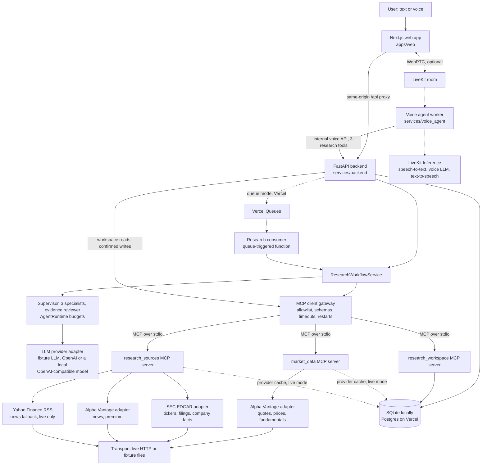
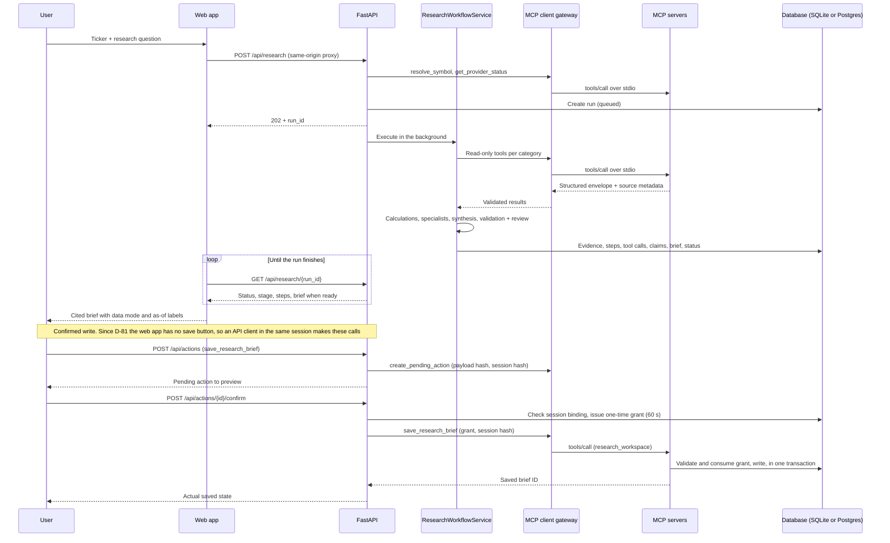

# MarketLens — Architecture and Phased Implementation Plan

**Product:** MarketLens, an AI market-research analyst for US equities (NYSE/Nasdaq)  
**Primary interaction:** Text, plus optional browser voice  
**Market-data sources:** deterministic synthetic fixtures (default) · Alpha Vantage (optional, plan-dependent) · SEC EDGAR public data · Yahoo Finance headline RSS (news fallback)  
**Implementation languages:** TypeScript (Next.js web app) and Python (backend, MCP servers, voice worker)  
**Database:** SQLite locally · Postgres when hosted on Vercel (D-98)  
**Status:** Implemented. All phase gates (0–7) have passed. Since then, live data (a free Alpha Vantage key, SEC EDGAR and Yahoo Finance headlines), a free local model (Ollama) and spoken voice sessions (LiveKit Cloud) have run on the development machine; OpenAI's hosted API has not (no key). See [`PROJECT_STATUS.md`](PROJECT_STATUS.md).  
**Last documentation review:** 2026-10-21 (chat-style workspace, ticker search, latest-only figures, news fallback, readable sources, sharing and PDF, voice with Lens, quick guide, research search, Vercel deployment as one project with Postgres and Vercel Queues; D-80 to D-98)

> **How to read this document.**
> - **§1–§5** describe the system as built. Where the build deliberately differs from the original plan, the text says so and cites the decision (D-xx) in [`PROJECT_STATUS.md` › Decision log](PROJECT_STATUS.md#4-decision-log). §2.2 collects those differences in one table.
> - **§6** keeps the original phase plan and gate criteria as written, each followed by its recorded result.
> - **§7** is the release checklist, with evidence for each item.
>
> The original plan text is preserved unchanged in `MarketLens_Claude_Code_Markdown_Pack.zip` (D-01).

## 1. Architecture principles

1. **Evidence before explanation.** Retrieve structured data and source documents before generating interpretations. Never ask an LLM to invent missing prices, financial metrics, dates, or citations.
2. **MCP is a real boundary.** The three servers are independent MCP processes. A client must list/discover their tools and invoke them through the current official MCP SDK. A direct function call alone does not count as MCP integration.
3. **One research workflow, two interaction modes.** Text and voice invoke the same `ResearchWorkflowService`; avoid duplicating financial logic in the frontend or voice conversation prompt.
4. **Constrained multi-agent orchestration.** Use a supervisor plus specialist research steps with defined inputs/outputs. Specialists are bounded tasks that return typed findings; they do not freely call one another or write persistent state.
5. **Deterministic arithmetic and business rules.** Price changes, period comparisons, freshness, symbol validation, missing-field checks, permissions, duplicate detection and persistence are code, not LLM judgments.
6. **Read-only financial environment.** No broker access, order execution or trading recommendation engine.
7. **Graceful configuration.** Fixture mode must work offline. Live market data, real LLM analysis and voice are separately configurable capabilities.
8. **Observable by design.** Every run produces a trace of steps, MCP calls, source IDs, timing, errors and final status without leaking secrets.

## 2. System context



- **Web → backend.** The browser talks only to one origin. Locally (and with a backend on its own host), a route handler (`apps/web/app/api/[...path]/route.ts`) forwards `/api/*` to `BACKEND_URL` at request time (a build-time rewrite until D-98). On Vercel, the project's routing sends `/api/*` straight to the backend service on the same address (D-99). The HTTP-only session cookie stays first-party, and no backend address or key is in the browser bundle (D-06).
- **Hosted on Vercel (D-98)**, as one project with two Vercel Services (`vercel.json`):
  - **Routing (D-99):** `/api/(.*)` → **`backend`** (FastAPI, entry point `vercel_backend.asgi:app`), then `/(.*)` → **`web`** (`apps/web`). Both are public on one address, so the session cookie stays first-party. `web` keeps a binding to `backend` (`BACKEND_URL`) for its `/api` forwarding route, which on Vercel isn't reached.
  - **Site password on both (D-99):** `proxy.ts` checks `SITE_PASSWORD` for pages, and the backend middleware checks it for `/api` (HTTP Basic; browsers resend the credentials they entered, so visitors sign in once). `PROXY_SHARED_SECRET` is refused on Vercel, because browsers can't send it.
  - **`backend`:** each instance runs migrations under a Postgres advisory lock and starts the three MCP servers as child processes in its lifespan; on Vercel they inherit the backend's import path, and their logs go to stderr.
  - **Vercel settings are enforced, not defaulted (D-101):** on Vercel, `load_settings` always uses `APP_ENV=production`, `RUN_EXECUTION=queue` and `MCP_LOG_DIR=-`, skips `.env`, and takes `POSTGRES_URL` when `DATABASE_URL` is unset, whichever module loads the app. Project variables that say otherwise (for example copied from `.env.example`) are ignored and listed in `/api/health` `warnings`.
  - **Setup problems answer instead of crashing (D-101):** an invalid configuration, or a database the backend can't open at startup, gives a 503 `BACKEND_MISCONFIGURED` on every `/api` request. The message names the fix, and the site's red bar shows it. Locally both still stop startup.
  - A Vercel Function can't keep working after it answers, so research runs execute through **Vercel Queues** (`RUN_EXECUTION=queue`):
    - `QueueRunManager` publishes `{run_id}` before answering.
    - The private subscriber `vercel_backend.queue_consumer` runs it with `run_consumer.run_queued_research`. That claims the run atomically (at-least-once delivery), executes the same `ResearchWorkflowService`, and watches the run row for a cancel request.
    - Runs still queued or running past `RUN_TIMEOUT_SECONDS` + 120 s are marked failed whenever runs are read (`sweep_stale`). Each gets its own reason: `RESEARCH_NOT_STARTED` (never picked up) or `RESEARCH_TIMED_OUT` (started, never finished). 
    - **Failures say why (D-102).** Every run that stops without a brief carries a code the page explains, with Re-run:
      - `RESEARCH_QUEUE_UNAVAILABLE`: the publish failed or took longer than 15 s (`PUBLISH_TIMEOUT_SECONDS`), so the start request answers at once instead of hanging.
      - `RESEARCH_NOT_STARTED` and `RESEARCH_TIMED_OUT`: the sweep above.
      - `RESEARCH_STOPPED`: the consumer failed on its last delivery (three in all, 30 s apart). The failure is recorded at once, and the consumer's logs hold the traceback.
    - The consumer logs its load and every delivery (`research run … delivery N of 3`), so the runtime logs show whether Vercel delivers runs at all.
    - The web app bounds its calls: 30 s by default and 45 s for starting a run. A call that times out says so and returns the button to ↑.
  - **State is in Postgres** (Neon from the Vercel Marketplace, or Supabase through its Transaction pooler), shared by every instance and the MCP servers.
  - **Voice is off** in the hosted version: it needs an always-on worker (a Pro-plan Daemon).
  - **Earlier hosting (D-94), still supported:** the web app alone on Vercel, and the backend on a container host (`render.yaml`, `Dockerfile.backend`, SQLite on a disk, research inline).
  - `apps/web/proxy.ts` (Next 16's renamed middleware) runs before every page and `/api` request:
    - It can ask for a site password (`SITE_PASSWORD`, HTTP Basic).
    - On `/api` requests it removes the browser's `Authorization` header and any client-sent secret, then adds `X-MarketLens-Proxy-Secret` (`PROXY_SHARED_SECRET`) server-side.
  - With `PROXY_SHARED_SECRET` set (needed only when the backend has a public address, as in D-94), the backend rejects every `/api` request without it (403). Two routes are exempt: `/api/health` (the host's health check) and the voice worker's internal API, which has its own token.
  - `APP_ENV=production` marks the session cookie `Secure`.
  - Locally none of these are set, and nothing changes.
- **Backend → tools.** All data access and every workspace read and write go through the MCP client gateway. The gateway talks to three separate MCP server processes over stdio. There is no in-process shortcut: the temporary Phase 1 in-process gateway was deleted in Phase 2 (D-29).
- **Voice is an interaction adapter, not a second research system.**
  - When voice is configured, the browser asks the backend for a voice session. It receives a short-lived, room-scoped LiveKit token and never the API secret. The token dispatches the voice worker into that room.
  - The worker's three tools call the backend's internal voice API, which runs the same `ResearchWorkflowService` and MCP servers as text mode (D-23, D-55, D-57).
  - Speech-to-text, the conversational model and text-to-speech run on LiveKit Inference (D-54). The research itself still uses the backend's LLM adapter.
- **Persistence.** One database, split by writer: a SQLite file locally, Postgres when hosted (D-98).
  - **Backend:** runs, evidence, claims, briefs, confirmation grants, voice sessions and analytics.
  - **Workspace MCP server:** pending actions, saved briefs and the watchlist; it writes only after consuming a grant.
  - **Read-only servers:** the provider cache, and only in live mode.

### 2.1 Repository layout

```text
apps/web/                         Next.js 16 web app (App Router, Tailwind 4); API types generated from the backend's OpenAPI
services/core/                    marketlens_core: shared config, domain models, errors, policy, calculations, trading calendar,
                                  provider adapters and transports, SQLite/Postgres migrations and repositories, confirmation service
services/backend/                 FastAPI app: HTTP API, ResearchWorkflowService, agents, LLM providers, MCP client gateway, voice API
services/mcp_market_data/         MCP server `market_data` (stdio, read-only)
services/mcp_research_sources/    MCP server `research_sources` (stdio, read-only)
services/mcp_research_workspace/  MCP server `research_workspace` (stdio, grant-gated writes)
services/voice_agent/             optional LiveKit voice worker: a separate uv project with its own lockfile (D-53)
data/fixtures/v1/                 synthetic, provider-shaped fixture dataset (55 files, as of 2026-09-30; D-12)
data/marketlens.db                local SQLite database (created on first start; git-ignored)
data/runtime/logs/                MCP server logs (git-ignored)
scripts/                          dev.py, seed_demo.py, run_evaluation.py, generate_fixtures.py, export_openapi.py
tests/                            unit, integration (real MCP servers), evaluation (49 cases), live (credential-gated)
reports/evaluation/               latest evaluation report (JSON and Markdown)
docs/                             five-minute demo script, feature checklist, testing guide, screenshots, Vercel + Render deployment guide
Makefile                          install / seed / start / run / stop / restart / status / logs / test / evaluate / lint (local toolchain, or Docker as a fallback)
Dockerfile, docker-compose.yml    optional Docker toolchain for running the app without local Node, pnpm or uv
Dockerfile.backend                production backend image (FastAPI plus the three MCP servers it spawns; SQLite on /data)
Dockerfile.voice                  optional voice worker image (LiveKit agent, no inbound port)
render.yaml                       Render Blueprint: the backend from Dockerfile.backend with a disk, demo mode, a generated proxy secret (D-94)
vercel.json                       Vercel Services: web (pages) and backend (/api), one address (D-98, D-99)
vercel_backend/                   the backend's Vercel entry points: asgi.py (the app) and queue_consumer.py (research runs)
scripts/run_queue_consumer.py     local stand-in for Vercel Queues delivery (queue-mode rehearsal)
apps/web/proxy.ts                 optional site password, and the backend shared secret added to /api requests (D-94)
```

Python is one uv workspace: a root `pyproject.toml` and one lockfile covering every `services/*` package except the voice worker (D-04). The worker is excluded because `livekit-agents` requires `openai<3` while the backend uses `openai` 3.x (D-53). The web app is a pnpm workspace member (`apps/*`).

### 2.2 Changes from the original plan

| Original plan | As built | Decision |
|---|---|---|
| Backend-local `app/config.py`, `app/domain/*`, `app/db/*` | A shared package, `services/core/marketlens_core`, used by the backend, the MCP servers and the voice worker, so no server imports the FastAPI app | D-04 |
| Browser calls the backend directly (`NEXT_PUBLIC_BACKEND_URL`) | Same-origin `/api/*` rewrite proxy; `BACKEND_URL` is server-side only | D-06 |
| `POST /api/research` synchronous or asynchronous | Asynchronous. Input and symbol coverage are validated first (4xx); then 202 with a `run_id`, and the UI polls | D-18 |
| Evidence reviewer before synthesis (§3.3 of the plan) | Deterministic pre-validation → supervisor synthesis from validated findings → the reviewer judges the draft → final deterministic validation. The stricter outcome wins | D-08, D-44 |
| Watchlist `POST`/`DELETE` change the watchlist | They only create pending actions (202). The write happens on `POST /api/actions/{id}/confirm` with a one-time grant | D-17 |
| `POST /api/voice/token` | `POST /api/voice/session`, plus session-state and end routes | D-56 |
| Voice agent calls `ResearchWorkflowService` in process and uses the backend's LLM adapter; tool `get_run_status` | A separate worker process calls the backend's internal voice API; speech runs on LiveKit Inference; the tool is `get_research_run_status` | D-53, D-54, D-55, D-57 |
| Generic news provider adapter | Alpha Vantage `NEWS_SENTIMENT` through the `research_sources` server; since D-86, when the plan lacks it (it is premium), Yahoo Finance's public headline RSS in live mode. Otherwise (fallback off, or fixture mode), the category is reported as unavailable | D-22 |
| MCP tool list as first drafted | Added `resolve_symbol`, a server-owned `session_id` on writes, URL-restricted `get_filing_excerpt` and idempotent removal | D-16 |
| Tables listed in the plan's §3.6 | Plus `saved_briefs`, `confirmation_grants`, `voice_sessions`, `analytics_events` and `provider_rate_limits` | D-17, D-55, D-65, D-77 |
| Separate pages: research home, run page, saved briefs, watchlist, settings | One chat-style screen: history rail on the left, the run in the middle, quick starts on the right, and a one-line research bar (ticker dropdown, dictation, voice session) docked at the bottom. Run details and comparisons open as dialogs. Saved briefs, the watchlist and data status have no UI (API only); `/research/[runId]` still opens a run | D-78, D-81, D-82, D-83 |
| OpenAI as the only real model | Any OpenAI-compatible endpoint through `OPENAI_BASE_URL`, so a free local model (Ollama) works without a key | D-76 |
| Alpha Vantage requests limited per process (D-40) | Pacing shared by every process through SQLite, one upstream call for identical concurrent requests, one retry after a per-second rejection, and the daily quota reported as such | D-77 |
| Deployment notes only; the app runs locally | One Vercel project (D-98, D-99): Services `web` (pages) and `backend` (`/api`), both behind `SITE_PASSWORD`; research runs on Vercel Queues, Postgres from the Marketplace, voice off. Before that (D-94): Vercel for the web app; a container host for the backend (Render Blueprint, `Dockerfile.backend`, disk at `/data`) and the voice worker (`Dockerfile.voice`); an optional site password and a backend shared secret added by `apps/web/proxy.ts`; `Secure` cookie in production | D-94, D-98, D-99 |

## 3. Components and responsibilities

### 3.1 Web app — `apps/web`

The web app is **one chat-style screen** (D-78, D-81, D-82). Nothing navigates away: starting research and opening a run happen in place.

```text
┌ mode banner (DEMO FIXTURES / LIVE DATA) ──────────────────────────────────────────────────────┐
│ logo                                         (🔍, History, Explore in narrower windows)    │  frozen
├──────────────┬─────────────────────────────────────────────────┬─────────────────────────────┤
│ [New] [🔍]   │ summary bar: ticker, status, price ▲ change,      │ try one of these           │  frozen
│ research     │ the full question · Re-run · Compare · Details    │ (quick starts, wide        │
│ history      ├───────────────────────────────────────────────────┤  screens; the evidence     │
│              │ Heads up · brief sections (the only part that     │  inspector takes this      │
│              │ scrolls)                                          │  place while it is open)   │
│              ├───────────────────────────────────────────────────┤                            │
│              │   Lens voice bar (after the large voice screen shrinks; ✕ ends the session)    │
│              │ ( [TICKER▾] What do you want to know?  [3 months▾] 🎙 〰 (↑) )  ← one line        │  frozen
│              │   research-only note                                                           │
└──────────────┴───────────────────────────────────────────────────┴────────────────────────────┘
```

- **Research bar (composer):** docked at the bottom of the main pane, centered and at most 56 rem wide, like ChatGPT's composer. In laptop and desktop windows it is one line: the ticker dropdown (5.5 rem), the question ("What do you want to know?", optional), the time-window menu in full words (3 months · 1 month · 6 months · 12 months · Custom dates; it sizes to the selected label), the dictation microphone 🎙, the voice-session button 〰 and the round **Research** (↑) button. In a very narrow window the menu and the buttons wrap to a second row. Enter submits; **Custom dates** adds a row of two date fields.
- **Dictation (D-83):** the microphone uses the browser's Web Speech API (`SpeechRecognition` / `webkitSpeechRecognition`, continuous with interim results, in the browser's language). Spoken words appear in the question box as you talk, after anything already typed; pressing ■ stops. Nothing is spoken back and no backend is involved: the browser's speech service transcribes (Chrome and Edge send audio to their vendor, Safari to Apple). Where the API is missing (Firefox) the button is dimmed and explains why. Dictation is off while a voice session runs, and starting a voice session stops it.
- **Ticker dropdown (D-82, D-84):** an ARIA combobox whose list always has values. Opening it (click, focus or ↓) shows, in groups, **In this research** (the ticker of the run on screen), **Recently researched**, and **Largest companies** (`GET /api/symbols` with no query; **In the demo data** in fixture mode); the chosen ticker is marked ✓ and its text is selected so typing replaces it. Typing a ticker or company name filters through `search_symbols`, debounced, opening upward. Arrow keys move, Enter or a click picks (focus then moves to the question), Esc closes. Empty, the field reads **Ticker** in the accent colour with an accent ring, so it is clear a ticker is needed. The field follows the run on screen (`RunView` reports its symbol through `setCurrentSymbol`) and clears on the welcome screen. Picking only fills the field: research still resolves the exact ticker submitted (D-15).
- **Search research (D-96):** a search icon beside **New research** in the history rail (in narrower windows, 🔍 in the header), or ⌘K / Ctrl+K anywhere, opens `SearchModal` (`workspace/search.tsx`), pinned near the top of the window (`Modal placement="top"`).
  - **Empty box:** it suggests **Tickers you've researched** (chips that search that ticker) and **Recent research**.
  - **Typing:** after 180 ms it calls `GET /api/research/search?q=` and lists the matches as an ARIA combobox (↑ ↓, Enter, Esc). The search words are highlighted in the ticker, company, question and finding snippet. While a new search runs, the previous results stay up.
  - **No match:** a hint and **Start a new research**.
  - Opening a result works like clicking it in the history.
- **Jump to bottom (D-84):** while a brief or the welcome screen has more below, a round ↓ button floats at the bottom centre of the scrolling pane, like ChatGPT's; it scrolls smoothly to the end and hides there.
- **PDF and sharing (D-87, D-91):** `PdfButton` at the top right of a run opens folded sections, sets the page title (the default file name) and calls `window.print()`; `print:` variants hide the header, rails, research bar, actions and inspector, unpin the summary bar and let the brief flow onto pages, and the dark palette applies on screen only (`@media screen and (prefers-color-scheme: dark)`), so the PDF is always light. `SectionActions` (Copy, Share) sit under each findings section and the Summary. Share links open the run where MarketLens runs; the text works anywhere.
- **Summary last (D-91):** the brief reads Heads up → header → key numbers → price, financials, filings, news → findings → gaps, set aside, sources, method → **Summary** → disclaimer.
- **Quick guide (D-92):** `GuideButton` opens "Explore MarketLens", a modal with nine topics (start, voice, waiting, reading, verifying, more actions, history, scope, tips) and topic chips; the trigger is a pill at the foot of the right-hand rail (≥1280 px) or "✦ Explore" in the header.
- **Readable sources (D-86):** `lib/readable.ts` names every source distinctly (calculation type, metric and period, filing form, news publisher) and describes its values in words for the source panel; `naturalize` strips evidence IDs and SEC tag names from any displayed text; the run details list data requests as plain steps ("Fetched daily prices · MSFT · Jul 12 – Oct 12, 2026") with plain failure reasons; no run IDs, hashes or field names are shown.
- **Badges explain themselves (D-84):** every status, data-mode, statement-type, freshness, fact-check, "default window" and Heads up data tag inside the brief is wrapped in `Hint` (since D-87 only in the brief; the history, summary bar and the rest of the screen have no hover hints): a small ⓘ icon (brighter on hover) and the help cursor show it can be hovered, and hover or keyboard focus shows the definition directly (D-85) (rendered on the page body so scrolling panes never clip it; Esc or scrolling closes it; screen readers get the text as a description). The brief header says so once. The partial status icon is ◐ (it was "!").
- **Quick starts:** on wide screens (≥1280 px) a right-hand **Try one of these** rail mirrors the history; it gives way to the evidence inspector while a source is open. On narrower screens the same cards sit on the welcome screen. Picking one fills the research bar without starting anything.
- **Full text:** the question in the run's summary bar and in the history wraps in full instead of being cut off.
- **Voice session in the research bar:** the sound-wave button (like ChatGPT's voice mode) starts a two-way voice session (it checks the microphone first) and, while live, turns into a stop button. The assistant is called **Lens** (D-89). Since D-88 the session opens a large voice screen (a dialog over a blurred page) with bars that move with the assistant's voice, the state in large type, the whole conversation (kept scrolled to the newest line, D-89), Mute mic, and a ✕ that ends the session (D-90: the single stop control; the earlier separate End session button and the ✕-to-minimize were merged, because two controls that looked alike did different things). When Lens starts research the history refreshes at once and the run carries a **Voice** tag there (D-90). If Lens says it is checking but no run starts within 15 s, the screen says the research hasn't started (D-89). When the assistant starts research, the run opens behind the screen and its progress card (phases, timer, Cancel) appears inside it; when the run finishes the screen shrinks to a slim bar above the research bar (Expand brings it back) so the brief is visible while the assistant speaks the summary. Audio: playback is unlocked as soon as the room connects, a large "Turn on the assistant's voice" button appears if the browser still blocks it, `RoomAudioRenderer` plays at full volume and stays mounted when the screen is minimized or expanded, and the worker greets only after the browser has joined the room (up to 10 s), so the greeting isn't lost. When voice isn't configured, the sound-wave button is dimmed and pressing it explains how to turn voice on.
- **Main pane:** shows a welcome screen (with quick starts below 1280 px), or a research run. The choice is kept in the address bar with `history.replaceState` (`/?run=…`), so refresh, back and shared links work without page navigation.
- **Dialogs:** run details (steps and every MCP tool call), period comparison, search, and the history in narrower windows. Dialogs render in a portal on the page body, trap focus, close with Esc and return focus to the control that opened them.
- **Narrower windows:** below 1024 px the history rail becomes a **History** dialog (search moves to a 🔍 button beside it) and below 1280 px the quick starts move to the welcome screen and the guide to **✦ Explore** in the header; the research bar stays at the bottom. MarketLens is built for desktop and laptop browsers (D-93).
- **Routes:** `/` (with `?run=` and `?symbol=`) and `/research/[runId]`, which opens that run in the same workspace. `/briefs`, `/watchlist` and `/settings` were removed in D-81 and show the not-found page.
- **Not in the web app (D-81):** saved briefs, the watchlist and the data-status dialog. Their API routes and the workspace MCP server are unchanged.

**Plain-language display (D-78):**
- **Dates** are formatted naturally ("Jun 30 – Sep 30, 2026"). This is display only: stored claims, evidence and validation are unchanged, and the inspector shows the exact source values.
- **Heads up card:** run errors are grouped by cause and explained in plain words, with what the reader can do; error codes are not shown. Examples: a provider limit, a data gap, a step that fell back, statements the fact-checker set aside.
- **Fact-check meter and freshness chips:** a meter shows how many statements were verified, read-with-care or set aside, and how many numbers matched. Chips show what date each data category describes and when it was fetched.
- **Latest figures only (D-85):** the research-sources server returns financial figures only for the newest reporting period, drops tags the company no longer uses, and withholds periods older than SEC filing deadlines allow; the brief never shows an "out of date" financial figure. Market prices are end-of-day and are flagged only if the provider falls behind.
- **Folded details:** unknowns are listed plainly. Notes from the AI analysts, statements set aside by the fact-checker, sources and the method fold away. Links to a section inside the brief ("See what was set aside") scroll only the brief, open the folded details and stop below the sticky summary bar; the app's outer frame is `overflow: clip`, so an anchor jump or focus can never shift the whole screen (D-84).

Responsibilities:
- **Interaction:** text is always available, and dictation needs no configuration. The voice-session button starts a session only when health reports voice as configured; otherwise it explains that voice is not configured.
- **Labeling:** the data mode is shown everywhere (the `DEMO FIXTURES` / `LIVE DATA` banner and badges on runs and briefs), and the research-only notice sits under the research bar.
- **Feedback and access:** run progress in four phases, partial reasons and recoverable errors, loading and empty states, keyboard access and live regions (D-66).
- **Writes:** none since D-81. The web app no longer proposes saves or watchlist changes; the backend still requires a confirmed, one-time grant for any write made through the API.
- **Voice (D-61):** microphone check, connection states, a live transcript (not stored), mute and end controls, and the text fallback.
- **Data access:**
  - Data is fetched client-side through the same-origin proxy (D-33).
  - TypeScript API types are generated from the backend's OpenAPI (`apps/web/openapi.json` → `lib/api/schema.d.ts`), and a contract test fails when they are stale (D-24, D-28).

Non-responsibilities: provider credentials, market-data calls, LLM calls, MCP server access, financial calculations, write authorization, API retries, or truth/safety decisions.

### 3.2 FastAPI backend — `services/backend`

```text
services/backend/app/
  main.py                 application factory; the lifespan applies migrations, marks interrupted runs as failed,
                          and starts and stops the MCP gateway
  container.py            wires settings, repositories, the MCP gateway and services
  api/
    health.py             /api/health and /api/data-status (configuration presence only, never secret values)
    research.py           research create (async), list, search (D-96), get, cancel and re-run
    symbols.py            ticker suggestions for the research bar (MCP `search_symbols`)
    workspace.py          saved briefs and watchlist, through the workspace MCP server
    actions.py            pending writes: propose → preview → confirm (grant + MCP write) or cancel
    compare.py            period comparison
    voice.py              voice sessions and the worker's internal API (hidden from OpenAPI)
    analytics.py          local analytics events and summary
    middleware.py         request IDs, server-owned session cookie (Secure in production), proxy shared secret or site password, body-size limit, response headers
    errors.py             one error envelope: stable code, safe message, request ID, no stack traces
    schemas.py, deps.py   HTTP response contracts (the source of the web types); FastAPI dependencies
  services/
    research_workflow.py  ResearchWorkflowService: the one workflow shared by text and voice
    run_manager.py        starts runs: inline background tasks (local) or Vercel Queues (hosted); cancellation, stale runs
    run_consumer.py       runs one queued run: atomic claim, execution, cancel watching (D-98)
    evidence_collector.py read-only MCP calls per category → evidence ledger and category status
    derived_metrics.py    deterministic calculations on retrieved evidence
    consistency.py        deterministic contradiction detection
    brief_composer.py     deterministic brief assembly, gaps and labeled fallbacks
    validation.py         the final claim-validation gate
    formatting.py         display formats that the validator parses back
    workspace.py          confirmed writes and workspace reads through MCP
    compare.py            two calculate_price_change calls through MCP
    voice.py              room-scoped LiveKit tokens; the worker's view of runs
    voice_summary.py      deterministic, speakable run summaries
  agents/                 supervisor, market / news & events / fundamentals specialists, evidence reviewer,
                          shared specialist base, strict contracts, prompts, AgentRuntime, fixture responders
  providers/llm/          LLMProvider interface, factory, fixture LLM, OpenAI Responses API provider
  mcp/
    gateway.py            tool allowlist, call outcome type, safe audit records
    client_gateway.py     MCP client over stdio: the backend's only path to tools
```

**Shared code** lives in `services/core/marketlens_core`:
- **Contracts and rules:** `config` (settings, startup validation and the demo guard), `models` and `tool_models` (domain and MCP contracts), `errors`, `policy` (research-only rules), `symbols`, `untrusted` (instruction-like text detection) and `hashing`.
- **Market logic:** `calculations` (Decimal) and `market_calendar` (NYSE).
- **Providers:** `providers/*` (Alpha Vantage and SEC adapters, plus live and fixture transports) and `fixtures`.
- **Persistence and writes:** `db/*` (connection, forward-only migrations, repositories), `actions` (pending actions and grants) and `analytics`.
- **Runtime support:** `voice` (room naming, the worker credential), `status`, `timeutil` and `mcp_support`.

**Changes from the planned module list:**
- The planned `research_orchestrator.py` is part of `research_workflow.py`, together with `run_manager.py`.
- `evidence_ledger.py` became `evidence_collector.py` plus the run repository.
- `action_confirmation.py` became `marketlens_core/actions.py` plus `services/workspace.py`.
- Configuration, domain and database modules moved to `marketlens_core` (D-04).

**LLM adapter and domain models:** the adapter exposes structured-output generation with schema validation, and domain models are independent of provider SDK types.

**HTTP routes.** The OpenAPI document is served at `/api/openapi.json` and exported to `apps/web/openapi.json`.

| Route | Purpose |
|---|---|
| `GET /api/health` | Status, modes, version, capability booleans, MCP server readiness and tools. Never secrets |
| `GET /api/data-status` | Data mode, reference clock, provider capabilities per server, latest research per symbol, notices |
| `POST /api/research` | Validate input and symbol coverage (4xx) and create the run; return 202 with `run_id`. The run executes in the background (D-18) |
| `GET /api/research` · `GET /api/research/{run_id}` | List runs · one run with its status, stage, steps, tool calls, evidence and brief |
| `GET /api/research/search?q=&limit=` | Search past runs (D-96). A run matches when every word of `q` (up to 6 words, case-insensitive, `%` and `_` literal) appears in its ticker, company name, question or a kept finding; statements set aside by the fact-checker are not searched. Results are ranked by match location (exact ticker, ticker prefix, company, question, finding) and then by recency, with `matched` set to that location. A `snippet` (about 150 characters, cut at word boundaries) shows the finding containing words the ticker, company and question don't. `q` is 1–100 characters; `limit` defaults to 8 (at most 20) |
| `POST /api/research/{run_id}/cancel` | Cancel a running run; the cancellation is persisted |
| `POST /api/research/{run_id}/rerun` | A new linked run (`origin: rerun`, `parent_run_id`) with the same parameters (D-62) |
| `GET /api/briefs` · `GET /api/briefs/{brief_id}` | Saved snapshots, read through the workspace MCP server |
| `GET /api/watchlist` · `POST /api/watchlist` · `DELETE /api/watchlist/{symbol}` | Read the watchlist · propose an addition or a removal (202, pending action only) |
| `POST /api/actions` · `GET /api/actions/{action_id}` | Propose a write; the server computes the payload and its hash · preview it |
| `POST /api/actions/{action_id}/confirm` · `POST /api/actions/{action_id}/cancel` | Session check → one-time grant → MCP write · cancel (D-17) |
| `POST /api/compare` | Two periods through MCP `calculate_price_change`; difference in percentage points (D-63) |
| `GET /api/symbols?q=` | Ticker suggestions for the research bar through MCP `search_symbols`: covered symbols whose ticker, or a word of the company name, starts with `q` (D-82) |
| `POST /api/voice/session` · `GET /api/voice/session/{room_name}` · `POST /api/voice/session/{room_name}/end` | Room-scoped LiveKit token (201) · session state · end (D-56) |
| `POST /api/analytics/events` · `GET /api/analytics/summary` | Browser-reported voice connection outcomes · aggregate usage counts (D-65) |
| `POST /api/internal/voice/rooms/{room}/research` · `GET …/status` · `GET …/summary` · `POST …/end` | Voice worker only, hidden from OpenAPI. The bearer token is derived from the LiveKit secret (D-55) |

**Rules that apply to every route:**
- State-changing requests need the `X-MarketLens-Client` header, a CSRF defense (D-37).
- The server owns an HTTP-only `SameSite=Lax` session cookie, which is also `Secure` with `APP_ENV=production` (D-94).
- With `PROXY_SHARED_SECRET` set (a backend on its own host), every `/api` request except `/api/health` and the voice worker's internal API must carry `X-MarketLens-Proxy-Secret`, or it gets a 403. The web app's proxy adds the header after checking the site password (D-94).
- Without a secret but with `SITE_PASSWORD` set (one Vercel project, `/api` routed straight to the backend), the same requests must carry the site password as HTTP Basic credentials, or they get a 401 with `WWW-Authenticate` (D-99).
- Request bodies are capped at `MAX_REQUEST_BODY_BYTES` (default 64 KiB) with a 413, streamed bodies included (D-71).
- CORS allows only `FRONTEND_ORIGIN`.
- Every error uses the same envelope.

MarketLens is a **single-user MVP**: one browser session cookie and no user accounts. Runs, briefs and the watchlist are shared by anyone who can reach the backend. Locally, startup warns when the backend binds to a non-loopback address. Hosted (D-94), it warns when `APP_ENV=production` has no `PROXY_SHARED_SECRET`, and the site password is one shared login. Every write still needs server-side validation and a confirmation grant. It is not hardened for public multi-tenant deployment (README › Deployment notes).

### 3.3 Research workflow and agents

The workflow is fixed code. Only the specialist, synthesis and review steps call the LLM. Each run records these ordered steps, which the UI shows as the run trace:

| # | Step key | Agent | What happens |
|---|---|---|---|
| — | *(request)* | — | `create_run` normalizes the symbol, checks coverage with `resolve_symbol`, reads provider status and stores the run as `queued` (D-15, D-18). The plan step reuses that status (D-70) |
| 1 | `plan` | `research_supervisor` (deterministic) | Evidence categories (market, fundamentals, filings, news), the research window and budgets. The default window is the 3 months up to the reference date, labeled as a default (D-10, D-11) |
| 2 | `collect_evidence` | `mcp_gateway` | Read-only MCP tools per category: quote, daily prices, price change, SEC company facts, filings with a risk-factor excerpt, and news. Provider fundamentals are used only as a fallback (D-21). Each result becomes an `EvidenceItem` with a deterministic ID (D-13); failures become category statuses, never data |
| 3 | `calculations` | `deterministic_calculator` | Decimal arithmetic (D-14): moves between consecutive NYSE trading days, ranges, year-over-year changes and margins. Also coverage shortfalls (D-67), freshness (D-68) and contradictions (D-48) |
| 4–6 | `market_specialist`, `news_specialist`, `fundamentals_specialist` | `market_data_specialist`, `news_events_specialist`, `fundamentals_specialist` | Run concurrently (`MAX_PARALLEL_SPECIALISTS`, default 3). Each has its own system prompt, evidence package and allowed sections, and no tools. Each returns a strict typed draft (D-42, D-43), which then gets deterministic pre-validation |
| 7 | `supervisor_synthesis` | `research_supervisor` | Summary, positive and negative evidence, interpretation and conditional scenarios, from validated findings only |
| 8 | `evidence_review` | `evidence_risk_reviewer` | Per-claim verdicts, merged with the deterministic validator; the stricter outcome wins. Failing claims are withheld with a reason; advice and instruction-like text are also redacted (D-44, D-49, D-50) |
| 9 | `finalize` | `research_supervisor` | Status rule and persistence (D-09, D-47). `completed` requires the mandatory evidence and every model step and the review to finish, with no material contradiction, stale market data or coverage gap. Otherwise `partial` with reasons, or `failed` when nothing safe remains |

**Run state:** `status` is one of `queued`, `running`, `partial`, `completed`, `failed`, `cancelled`. A separate `stage` field tracks the position in the workflow (D-07). Runs found `running` at startup are marked failed ("interrupted by restart").

**Validation** (`services/validation.py`) checks every claim:
- its evidence IDs exist in the run, and the claim type fits the evidence kind;
- every number and date appears in the cited evidence;
- there is no unhedged causal wording and no quarterly-vs-annual comparison;
- it contains no advice, trading or instruction-like text.

Model-written free text (unknowns, notes, reviewer reasons) is shown only when it passes the same grounding rules (D-49).

**Budgets** (`agents/runtime.py`, D-45):
- **Calls:** at most `MAX_LLM_CALLS_PER_RUN` (default 8; a full run uses 5), with one retry for retryable failures.
- **Time:** a per-call timeout of `OPENAI_TIMEOUT_SECONDS` + 5 s. No call may outlive the run deadline: `RUN_TIMEOUT_SECONDS` (default 120 s) minus 5 s reserved for finalizing.
- **Fallback (D-46):** a step that fails, or cannot start in time, falls back to a labeled deterministic summary, and the run becomes `partial`.

**LLM providers:** the deterministic fixture LLM (the default; no network) and the OpenAI Responses API adapter, which uses strict JSON-schema outputs and `store=false` (D-25, D-51). Model output never assigns claim IDs, materiality, section scope or validation status (D-42).

### 3.4 MCP servers

Three independent processes on the official MCP Python SDK (2.3.0), over stdio. The backend's gateway starts one process per server. Each server can also run standalone, with `python -m mcp_market_data` (and the equivalents) or the `marketlens-mcp-*` console scripts.

| Server | Tools | Notes |
|---|---|---|
| `market_data` (read-only) | `get_quote`, `get_historical_prices`, `calculate_price_change`, `get_financial_metrics`, `get_provider_status` | Alpha Vantage adapter; Decimal calculations; reports trading days that have no bars |
| `research_sources` (read-only) | `resolve_symbol`, `search_symbols`, `get_sec_company_facts`, `search_company_filings`, `get_filing_excerpt`, `search_company_news`, `get_research_sources_status` | SEC EDGAR adapter and Alpha Vantage news, with Yahoo Finance RSS as the live news fallback (D-86). Excerpt URLs must belong to the issuer's SEC filings |
| `research_workspace` | `list_watchlist`, `list_saved_briefs`, `get_saved_brief`, `create_pending_action`, and the grant-gated writes `save_research_brief`, `add_watchlist_symbol`, `remove_watchlist_symbol` | Validates and consumes a one-time grant and performs the write in one `BEGIN IMMEDIATE` transaction (D-36) |

Contracts are in [`MCP_TOOLS.md`](MCP_TOOLS.md). Every tool declares a description and JSON input and output schemas. It returns a `CallToolResult` whose structured content is the shared result envelope, with `is_error` mirroring `ok` (D-34).

The **MCP client gateway** (`app/mcp/client_gateway.py`, D-35):
- **Allowlist:** fails closed if a server advertises any tool outside the allowlist. An import-time check ensures no allowlisted name contains a trading-like fragment.
- **Call checks:** validates arguments against the discovered input schema before calling, and enforces `MCP_TOOL_CALL_TIMEOUT_SECONDS` (default 20 s).
- **Recovery:** restarts a dead server with bounded backoff (up to 8 s). Until then it reports the server as unavailable, never as data, and it never retries writes.
- **Process environment:** gives each child a minimal, explicit environment; the workspace server never receives provider keys (D-20).
- **Audit:** records every call in `tool_calls` (server, tool, input and output summaries, latency, status, idempotency key), without secrets.

No MCP server exposes filesystem, shell, SQL, URL-fetch or trading tools. The agents themselves have no tools.

### 3.5 Provider adapters

**Alpha Vantage** (`marketlens_core/providers/alpha_vantage.py`): quotes, daily prices, the fundamentals fallback and news, where the user's plan provides them.
- **Errors:** one module holds the endpoint mapping. HTTP-200 bodies carrying `Information`, `Note` or `Error Message` are classified as rate-limit, capability, input or auth errors.
- **Quotes:** carry a trading date only, so `observed_at` is null and the market state is unknown (D-22).
- **Daily bars:** unadjusted unless the premium adjusted series is available; `compact` output covers about 100 trading days.
- **News:** timestamps have no time zone, and are shown as such. `NEWS_SENTIMENT` is a premium endpoint (free keys are refused).
- **Rate limits (D-40, D-77):**
  - Free keys allow about one request per second and 25 a day. Both read-only MCP servers call Alpha Vantage, so the pacing is **shared across processes**: each request reserves the next slot in the `provider_rate_limits` table inside a `BEGIN IMMEDIATE` transaction. The spacing is twice `60 / ALPHA_VANTAGE_MAX_REQUESTS_PER_MINUTE` seconds (2 s at the default), because a real run still drew a burst rejection at about 1.1 s spacing.
  - Identical concurrent requests in one process share one upstream call. For example, the price-history and price-change tools need the same daily series, so a typical run makes at most three requests (quote, daily prices, news). After the first premium refusal the `research_sources` server stops asking Alpha Vantage for news until it restarts, so later runs on a free key make two.
  - Limit messages are classified as per-second ("burst"), per-minute, daily or unspecified. A burst rejection is retried once after 1.5 s; the daily quota is reported as such ("new requests work again tomorrow") and is not retried.

**SEC EDGAR** (`marketlens_core/providers/sec_edgar.py`):
- **Coverage:** maps tickers to CIKs with the SEC's ticker/exchange file, restricted to NYSE and Nasdaq. Class shares match with either separator (`BRK.B` or `BRK-B`), and the run uses the SEC's spelling (D-79). Reads submissions, XBRL company facts and filing documents.
- **Values (D-30):** each value comes from the latest filing that reports its period (restatement-aware), and its fiscal labels from the earliest. Year-over-year comparisons match periods by dates.
- **Fair access (D-39):** requests send `SEC_USER_AGENT` and stay under 5 requests per second, with at most 2 concurrent requests. Responses are cached.

**Yahoo Finance headlines** (`marketlens_core/providers/yahoo_news.py`, D-86): the live-mode news fallback when Alpha Vantage refuses news as premium (`NEWS_FALLBACK=yahoo_rss`, default; `none` turns it off).
- **Feed:** the public per-ticker RSS (`YAHOO_NEWS_BASE_URL`), no key; about the latest 20 headlines, with zoned times (stored as UTC), a link and a short description; no relevance or sentiment.
- **Safety:** parsed with defusedxml (DTDs forbidden); only http(s) links; HTML stripped; the usual untrusted-text cleaning and injection flags; only headlines that name the ticker or the company's first name word are kept.
- **Cost:** after one premium refusal the server skips Alpha Vantage news for its lifetime, saving one daily request per run; feed responses are cached like other news.

**Latest figures only (D-85):** `get_sec_company_facts` returns only the newest reporting period; tags the issuer stopped using go to `missing_concepts`, and a period older than SEC filing deadlines allow returns no figures. The Alpha Vantage fundamentals fallback drops overdue series the same way.

**Transports.** The adapters parse responses from one of two transports:
- **Live HTTP (D-39):**
  - timeouts, plus a SQLite `provider_cache` with per-endpoint TTLs whose keys exclude API keys;
  - bounded backoff with jitter (capped at 4 s), at most one retry on a 429, and the Alpha Vantage pacing and burst retry above.
- **Fixture (D-12):** serves the provider-shaped files in `data/fixtures/v1/` through the same parsing code. Fixture records carry `is_fixture: true` and `source_mode: fixture`, and use `example.com` URLs, so they cannot pose as real filings or news.

**LLM endpoint: why an optional `OPENAI_BASE_URL` (free local model).** The project must be usable at no cost, and OpenAI's API is paid. The adapter therefore accepts an optional `OPENAI_BASE_URL`, which points the same OpenAI SDK client at any OpenAI-compatible server. The documented free option is a local [Ollama](https://ollama.com) server (`http://127.0.0.1:11434/v1`), which needs no account and no API key.
- **Why this approach:** it is a few lines in the adapter, so the strict structured-output contracts, the budgets, the validator and the labeled fallbacks are unchanged. A second provider implementation would duplicate all of that.
- **Keys:** a loopback endpoint needs only `OPENAI_MODEL`. A remote endpoint still requires `OPENAI_API_KEY`, and the key never leaves the server.
- **Timeouts:** local models need a longer per-call timeout. In a real run, `OPENAI_TIMEOUT_SECONDS=45` timed out two specialists on a 7B model; use 240.
- **Quality caveat:** a small local model is weaker than a hosted one. The deterministic validator and reviewer still withhold unsupported claims, and a step the model cannot complete falls back to the labeled deterministic summary, so a weak model lowers report quality but not safety.
- **Status:** see `PROJECT_STATUS.md` (D-76) for what was run against a local model.

**No silent substitution.** Live-mode failures map to structured errors (`RATE_LIMITED`, `PROVIDER_TIMEOUT`, `MALFORMED_PROVIDER_RESPONSE`, `CAPABILITY_UNAVAILABLE`, …), and the category is reported as failed or unavailable. Fixtures are never used in a live report.

### 3.6 Persistence (SQLite locally, Postgres hosted)

- **Location:** `DATABASE_URL`.
  - **Locally**, a SQLite file (default `data/marketlens.db`, resolved against the repository root; D-19).
  - **On Vercel**, Postgres (`postgresql://…`, D-98). `open_database(settings)` picks the implementation, and the backend and every MCP server use the same one.
- **Schema:** Migrations are versioned and forward-only: `marketlens_core/db/migrations/` for SQLite (foreign keys on) and `migrations_postgres/` for Postgres, with the same version numbers and tables.
  - The Postgres copy differs only where it must: identity columns instead of `AUTOINCREMENT`, `DOUBLE PRECISION` for the rate-limit time, and an explicit `rowid` identity on `evidence_items`, so `ORDER BY rowid` keeps insertion order in both.
- **Safety:**
  - SQLite migrations re-check their version under the write lock, so concurrent processes cannot apply one twice (D-41). Postgres applies all pending migrations in one transaction under an advisory lock, safe with many serverless instances.
  - Startup refuses a schema newer than the code, and nothing is dropped outside tests.
- **Write semantics:** SQLite writes use `BEGIN IMMEDIATE`. Postgres writes take one transaction-scoped advisory lock first, so every check-then-write (grant consumption, watchlist, rate-limit pacing) keeps the same guarantee.
- **Postgres connections:**
  - Each process keeps a small `psycopg_pool` pool. There are no server-side prepared statements, so Neon's pooled URL works, and connections are checked on checkout after a serverless freeze.
  - Repositories write `?` placeholders. Two dialect differences are exposed as helpers: `Database.like` (`ILIKE` on Postgres) and `Database.json_text`.

| Migration | Tables |
|---|---|
| `0001_initial.sql` | `research_runs`, `research_steps`, `tool_calls`, `evidence_items`, `research_claims`, `research_briefs`, `saved_briefs`, `watchlist_items`, `pending_actions`, `confirmation_grants`, `audit_events`, `provider_cache` |
| `0002_voice_sessions.sql` | `voice_sessions`: binds each room to the browser session that created it, with expiry and the active run |
| `0003_analytics.sql` | `analytics_events`: allowlisted event names and codes-only properties |
| `0004_provider_rate_limits.sql` | `provider_rate_limits`: the next allowed request time per provider, shared by the MCP server processes (D-77) |

**Who writes what:**
- **Backend:** runs, steps, tool calls, evidence, claims, generated briefs, voice sessions and analytics. It also issues confirmation grants through the shared `ActionService` (D-38).
- **Workspace MCP server:** creates pending actions, consumes grants and owns `saved_briefs` and `watchlist_items`.
- **Read-only servers:** only `provider_cache` and `provider_rate_limits`, and only in live mode.

**Snapshots, hashing and audit:**
- Saved briefs are snapshots: they keep the run's brief, evidence, as-of dates and data mode unchanged.
- Grant IDs and session identifiers are stored only as hashes (D-17, D-36).
- `audit_events` records writes and key safety decisions, including rejected grants.

### 3.7 Voice session

- **Optional and isolated.**
  - `VOICE_MODE=livekit` enables voice. The worker is a separate uv project (`services/voice_agent`, `livekit-agents` 1.8) that depends only on `marketlens-core` and imports no backend code (D-53).
  - Text mode never depends on it. Without configuration, `POST /api/voice/session` returns 409 `VOICE_NOT_CONFIGURED`, and the UI shows setup steps.
- **Tokens** (`POST /api/voice/session`, D-56):
  - **Room:** an unguessable room name (`ml-voice-…`), a random identity, and a TTL of `VOICE_SESSION_TTL_SECONDS` (default 600 s).
  - **Grants:** join, subscribe and data, with publishing limited to the microphone. No admin grants.
  - **Dispatch:** the room configuration dispatches `LIVEKIT_AGENT_NAME` explicitly. Room empty and departure timeouts are 60 s and 20 s.
  - **Limits:** at most 6 sessions per browser session per 10 minutes. The API secret never leaves the server.
- **Speech pipeline** (D-54):
  - LiveKit Inference provides speech-to-text, the LLM, text-to-speech and the turn detector.
  - Model IDs come from `VOICE_STT_MODEL`, `VOICE_LLM_MODEL` and `VOICE_TTS_MODEL`, with no defaults. The voice LLM must call tools reliably: with the starter's `google/gemma-4-31b-it`, Lens sometimes said it was checking without starting research (D-89); `openai/gpt-4.1-mini` is the tested choice.
- **Lens** (D-89): the assistant introduces itself as Lens. Its instructions require calling `run_company_research` in the same turn as the ticker confirmation and forbid saying "checking" before the tool has returned. It greets only after the browser has joined the room (up to 10 s, D-88).
  - This requires a LiveKit Cloud project; self-hosted speech pipelines are not implemented.
- **Tools** (D-55, D-57):
  - There are exactly three: `run_company_research`, `get_research_run_status` and `get_brief_summary`. The backend's internal voice API serves them, authenticated by a bearer token of `HMAC-SHA256(LIVEKIT_API_SECRET, fixed purpose label)`.
  - `voice_sessions` binds each room to the browser session that created it, so the worker sees only that session's runs. Voice runs carry `origin: voice`.
  - There are no save, watchlist or MCP tools. A repeated start for a symbol that is still running reuses that run.
- **Long runs** (D-59):
  - Research runs in the backend regardless of speech, interruptions or disconnects.
  - A progress watcher gives at most one "still working" update (after 20 s), then asks the agent to report completion or failure.
- **What is spoken** (D-58):
  - Summaries are deterministic and built by the backend from validated claims. The focus is one of overview, market, financials, risks, news or unknowns.
  - The status comes first, followed by the synthetic-data caveat. Dates are spoken as dates, and evidence IDs and XBRL names are dropped.
  - The voice model is instructed to use only these sentences.
- **Failures and privacy** (D-60, D-61):
  - If the agent session dies, the worker publishes a `marketlens.voice_error` code and ends the job, and the browser shows the specific reason.
  - Session recording is off and audio never reaches the backend. Transcripts are displayed live but not stored.
- **Browser** (D-88 to D-90): the session opens a large voice screen (voice-following bars, state, the conversation kept scrolled to the newest line, Mute mic, ✕ to end); the voice-started run opens behind it with its progress card inside the screen, appears in the history at once with a **Voice** tag, and the screen shrinks to a bar when the run finishes. Audio is unlocked on connect, with a large "Turn on the assistant's voice" button if the browser still blocks it.

### 3.8 Testing and evaluation

| Suite | What it covers |
|---|---|
| `tests/unit` | Calculations, the trading calendar, adapters and transports, validation, agents and runtime, the OpenAI adapter (mocked HTTP), persistence and migrations, analytics, voice summaries, `.env.example` sync |
| `tests/integration` | API routes and confirmation grants. Real MCP servers spawned over stdio: every tool, malformed arguments, faults, and live mode against a fake upstream. The full agent pipeline, the voice API, and security (secrets, CORS, body limits, allowlists, bounded retries, no external connections) |
| `tests/evaluation` | 49 versioned JSON cases in 8 categories, run against the real API, MCP servers and fixture LLM. Every number is recomputed independently from the raw fixtures (`ground_truth.py`). Metrics and release gates follow [`EVALUATION.md`](EVALUATION.md) (D-72) |
| `services/voice_agent/tests` | Worker tools, the progress watcher, a real `AgentSession` with a scripted LLM, worker configuration |
| `tests/live`, `services/voice_agent/tests/live` | Credential-gated smoke tests (real providers, OpenAI, LiveKit speech), skipped unless `MARKETLENS_LIVE_TESTS=1` |

- `scripts/run_evaluation.py` writes `reports/evaluation/latest.{json,md}` and exits non-zero on any failure or missed gate.
- Deterministic suites need no credentials and make no external network connections.
- Results are recorded in `PROJECT_STATUS.md` and the evaluation report.

### 3.9 Local operations

- **`scripts/dev.py`** (also `pnpm dev`, D-73):
  - Starts the backend (uvicorn with reload) and the web app (`next dev`), plus the voice worker with `--voice`.
  - Waits for health and then prints the URLs. `--api-port` and `--web-port` choose other ports.
  - Ctrl+C stops the whole process tree, including the MCP servers.
- **Make targets:**
  - `make start` runs `scripts/dev.py` in the background (PID file and log in `data/runtime/`). `make stop`, `make status` and `make logs` stop it, check it and follow its log; `make run` runs it in the foreground.
  - They use the local toolchain when uv, pnpm and Node are installed, and Docker (`docker-compose.yml`) otherwise.
  - `make start` seeds the demo data unless `.env` selects live data or a real model.
  - `make start` and `make run` add `--voice` when `.env` has `VOICE_MODE=livekit`, and `make status` then reports the worker (D-80). Docker runs without the worker.
- **Deployment (D-98):**
  - One Vercel project from `vercel.json`: services `web` (pages) and `backend` (`/api`), Vercel Queues for research runs, Postgres from the Marketplace (D-98, D-99). The steps are in `docs/DEPLOY_VERCEL.md`.
  - The project's Framework Preset must be **Services**, with Root Directory `./`. With any other preset, Vercel ignores the `services` key and builds one app (D-100).
  - The earlier split (D-94: the web app on Vercel, the backend from `render.yaml` / `Dockerfile.backend`) remains an alternative.
  - The voice worker image (`Dockerfile.voice`) is kept for a later always-on host.
- **`scripts/seed_demo.py`** (D-74): fixture-only, idempotent demo data, created through the public API and the confirmation flow.
- **`scripts/generate_fixtures.py [--check]`** regenerates the fixture dataset byte for byte.
- **`scripts/export_openapi.py [--check]`** refreshes the web app's API schema.
- **Configuration:**
  - Environment variables or a git-ignored `.env`. `.env.example` documents every variable, and a test keeps it in sync.
  - Invalid combinations stop startup with an actionable message. For example, `APP_MODE=demo` requires fixtures and the fixture LLM (D-19). An invalid value is reported by the variable's name and the rule, never by the value (D-101).
  - An empty variable (`NAME=`) means "use the default" (D-101).
  - Hosted on Vercel, the hosted profile is enforced and setup problems answer with a 503 instead of crashing (§2, D-101).

## 4. Data contracts

Where the contracts live:
- **Domain types:** `services/core/marketlens_core/models.py`.
- **MCP tool inputs and results:** `tool_models.py`, shared by the servers (producers) and the backend (consumer).
- **Strict LLM contracts:** `services/backend/app/agents/contracts.py`.
- **HTTP response contracts:** `app/api/schemas.py`, from which the web's TypeScript types are generated.

Main types:
- `ResearchRequest`: `symbol`, `question`, `time_horizon`, `focus_areas`, `requested_mode`, `client_request_id`.
- `ResearchRun`:
  - identity and request: `run_id`, `symbol`, `company`, `question`, `time_horizon`, `focus_areas`;
  - state: `status`, `stage`, `is_partial`, `errors`, `cancel_requested`;
  - context: `data_mode`, `llm_mode`, `origin` (e.g. `voice`, `rerun`), `parent_run_id`;
  - timing: created, updated, started and completed timestamps, plus `duration_ms`.
- `EvidenceItem`:
  - identity: `evidence_id` (deterministic `ev_{kind}_{12 hex}`), `kind` (`price_series`, `quote`, `financial_metric`, `filing`, `news`, `calculation`);
  - source: `source_name`, `provider`, `source_url`, `source_mode`, `is_fixture`;
  - time: `published_at` (with whether its time zone is known), `period_start`/`period_end`, `retrieved_at`, `freshness`;
  - content: `currency`, `units`, `content_hash`, `excerpt` or `payload`, and `flags` (e.g. instruction-like text).
- `ResearchClaim`:
  - content: `claim_id`, `section`, `text`, `evidence_ids`, `materiality`;
  - `claim_type`: `source_fact`, `calculation`, `interpretation` or `scenario`;
  - `validation_status`: `supported`, `needs_qualification`, `unsupported`, `date_mismatch`, `numeric_mismatch`, `contradicted` or `unverified`, plus `validation_notes`;
  - `confidence_note`: explanatory text, never a probability;
  - `produced_by`: e.g. a specialist or `deterministic_fallback`.
- `ResearchBrief`:
  - header: title, company, question, time horizon, `report_status`, `data_mode`, `llm_mode`, `is_fixture` and `as_of` metadata;
  - content: key metrics, recent events, claims and withheld claims, unknowns and gaps;
  - sources: source-quality notes, sources and per-category source status;
  - method and notices: methodology, limitations, the review summary, the disclaimer and the fixture disclosure.
- `MarketQuote`: `symbol`, `price`, `currency`, `observed_date`, `observed_at` (null when the provider gives only a date), `observation_basis`, `provider`, `market_state`, `previous_close`, `volume`, `is_fixture`.
- `PriceBar`: `trading_date`, open, high, low, close and `volume`, grouped in a `PriceSeries`.
- Workflow and workspace types: `AgentStep`, `ToolCallRecord`, `DataSourceStatus`, `WatchlistItem`, `SavedBrief`, `PendingAction` and `ConfirmationGrant`, as named in the plan.
- Tool-result types: `PriceChangeCalculation`, `FinancialMetric`, `FilingRecord`, `FilingExcerpt`, `NewsArticle` and `CompanyIdentity`.

Rules:
- Timestamps are ISO-8601 with a time zone.
- Enums cover run status, stage, evidence kind, claim type, validation status, source mode and category status.
- Values and currency units are preserved from the source and parsed to `Decimal`.
- Missing fields stay null and are shown as "not provided by source".
- Market state and timestamps are never inferred from the system clock.

## 5. API flow



Voice uses the same flow. The worker's `run_company_research` calls `POST /api/internal/voice/rooms/{room}/research`, which creates a run for the browser session bound to that room. `get_research_run_status` and `get_brief_summary` read that run, and the browser shows it in the same workspace as text research (it opens behind the Lens voice screen as soon as research starts, and appears in the history with a **Voice** tag).

## 6. Phased implementation — each phase has a gate

This is the original phase plan, kept as written. Each phase ends with its recorded result. The full evidence, commands and test output are in [`PROJECT_STATUS.md` › Gate records](PROJECT_STATUS.md#5-gate-records).

### Phase 0 — Product definition and build contract

**Goal:** Define the first useful research workflow, not an unbounded finance assistant.

**Description:**
- Read all specification files and reconcile contracts before coding.
- Create `PROJECT_STATUS.md` and a short decision log.
- Define a single happy-path request: “Research AAPL over the last 3 months; explain notable movement; review recent news and latest available filings; list risks and unknowns.”
- Define a deliberately limited symbol set for fixtures (e.g. AAPL, MSFT, NVDA) and one default demo report.
- Define the KPI tree and evaluation gate in `EVALUATION.md`.
- Add a concise architecture diagram to the README (can link to this file).

**Outcome:** Product scope, contracts and acceptance criteria are fixed before framework-generated code lands.

**Gate / acceptance criteria:**
- Every MVP feature is in `PRD.md` and every tool is in `MCP_TOOLS.md`.
- No-trading restriction is stated in the UI copy and server-side code comments/policies.
- The first fixture-mode report can be described using known fixture evidence; missing evidence behavior is explicit.

**Result: passed** (documentation gate). The UI-copy item was verified in Phase 1.

### Phase 1 — Foundation and deterministic text experience

**Goal:** Establish a working frontend/backend contract and a testable vertical slice before live providers or voice.

**Description:**
- Generate the Next.js app using current recommended TypeScript/App Router defaults; use `pnpm` and lockfile.
- Create FastAPI app, configuration parser, typed domain models, SQLite initialization and `/api/health`.
- Add fixture data and `FixtureProvider` / `FixtureLLMProvider`.
- Build research home, result view, evidence inspector shell, watchlist shell and visible DEMO FIXTURES banner.
- Implement `POST /api/research` against a deterministic orchestrator that returns a fixed but correctly sourced report.
- Add request/response validation and API error model.

**Outcome:** A locally running app can submit a research question and display a deterministic, explicitly labeled report without any external key.

**Gate / acceptance criteria:**
- Frontend start, backend start, API health, unit tests and frontend build pass.
- Fixture report renders actual fixture values and links/evidence identifiers from fixture files.
- Unknown symbols and invalid input return actionable 4xx responses.
- A provider or LLM key is not needed for fixture tests.

**Result: passed (2026-10-09).** 103 Python tests passed. Web lint, typecheck and build were clean. The fixture report's values were checked against the raw fixture files and verified in the browser.

### Phase 2 — Provider adapters, MCP servers and persistent state

**Goal:** Replace simulated internal data calls with genuine protocol-based MCP tool calls and provider adapters.

**Description:**
- Implement three independently runnable MCP server processes using the official Python SDK.
- Implement `MarketDataProvider` interface, initial Alpha Vantage adapter, SEC EDGAR adapter, news capability detection and deterministic fixture adapter.
- Implement `MCPClientGateway` with explicit server/tool allowlist, timeouts, error translation, argument/result validation, and safe logging.
- Add provider caches and bounded rate control. Apply SEC User-Agent and fair-access guidance.
- Implement workspace repositories for watchlist and saved briefs; add schema initialization/migrations.
- Implement pending-action confirmation mechanism. A tool can only persist after the server validates a one-time, unexpired, session/run-bound grant that was issued after a UI confirmation click.
- Add MCP integration tests that spawn actual server processes, list tools and call every exposed tool.

**Outcome:** A research request can access live provider data when configured, and all server integrations work deterministically in fixture mode. The report can be saved through an authorized MCP write call.

**Gate / acceptance criteria:**
- Every named tool in `MCP_TOOLS.md` is registered and has schema/description.
- MCP tests use MCP protocol calls, not direct service calls.
- Live-mode failures cannot silently become fixture results.
- Alpha Vantage quota errors, SEC rate limiting, malformed upstream responses and timeouts map to safe structured errors.
- Confirmation tests prove that missing, invalid, expired, reused, wrong-session and payload-mismatched grants cannot write.
- Watchlist/save changes persist through restart.

**Result: passed (2026-10-09).** 187 tests passed. They include real MCP stdio servers, every tool, malformed arguments and all grant-misuse cases. The live-provider smoke test was **not run** (no credentials); live behavior was verified against a fake upstream.

### Phase 3 — Research supervisor, specialist tasks and evidence validation

**Goal:** Create differentiated agentic reasoning that converts gathered evidence into a reliable research report.

**Description:**
- Add configured `LLMProvider` interface and an OpenAI provider with structured-output schema validation. Keep model identifiers in environment config.
- Implement supervisor planning and dedicated market, news/events, fundamentals and evidence-reviewer specialist prompts/modules.
- Gather independent evidence categories concurrently with bounded concurrency; do not fan out unbounded LLM or provider requests.
- Enforce typed JSON outputs, evidence ID requirements, deterministic calculation checks and conflict detection.
- Run a final validation pass that removes or qualifies material claims without sufficient evidence.
- Build step progress events, partial-result status, cancellation and retry behavior.
- Use `FixtureLLMProvider` for deterministic tests and reserve real-model smoke tests for configured environments.

**Outcome:** Text mode produces a genuine multi-specialist research report with traced data sources and explicit unknowns.

**Gate / acceptance criteria:**
- At least three distinct specialist roles are executed for a full report; evidence reviewer validates the supervisor output.
- Specialists have constrained responsibilities and return typed results.
- Numbers match provider/fixture data or deterministic calculations.
- Unsupported statements are rejected or marked as unverified; citations point to real evidence IDs.
- Missing source categories produce a partial report or explicit unavailable category, not fabricated content.
- Evaluation cases for contradictions, date mismatch, stale data and prompt injection pass.

**Result: passed (2026-10-09).** 242 tests passed and 2 were skipped (credential-gated). The mutation check caught 3/3 regressions. The real-model smoke test was **not run** (no credentials); the OpenAI adapter was verified against mocked HTTP.

### Phase 4 — Voice experience with shared research workflow

**Goal:** Allow a user to start and refine research through natural spoken conversation.

**Description:**
- Integrate LiveKit Agents using current official Python documentation. Select a supported STT/LLM/TTS or realtime-model path and pin dependencies.
- Add backend token route with short expiry and room/session scoping; never expose API secret.
- Add browser voice UI with microphone permission flows, listening/speaking/processing states, transcript, mute/end buttons, interruption handling, reconnect behavior and text fallback.
- The voice agent may call only bounded tools, especially `run_company_research`, `get_run_status`, and `get_brief_summary`; it must invoke the shared workflow.
- Forward progress safely so long research runs provide status updates; do not read the entire report aloud without asking. Speak a concise summary and invite follow-up.
- Test voice adapter independently with mocked session/events; run real speech smoke test only when credentials are configured.

**Outcome:** A user can speak a research question, hear a concise answer, view the full cited brief, and ask contextual follow-up questions.

**Gate / acceptance criteria:**
- With valid credentials, microphone-to-agent-to-research-to-spoken-summary path works in a supported browser.
- With missing voice configuration, text mode still works and voice is clearly disabled.
- Denied microphone permission, disconnects, delayed research and user interruptions are handled gracefully.
- Voice follow-up does not lose ticker/report context within a session.
- The voice agent cannot bypass write confirmations or use trading tools.

**Result: passed (2026-10-09); the real speech path was not run.** Without LiveKit Cloud credentials, the path was verified in segments:
- a local LiveKit server: token, room join, microphone publish and agent dispatch;
- the worker against the running backend;
- a real `AgentSession` with a scripted LLM.

As built, the token route is `POST /api/voice/session` and the status tool is `get_research_run_status` (D-56, D-57).

### Phase 5 — Research workspace and product-quality UX

**Goal:** Make MarketLens useful beyond a one-off answer.

**Description:**
- Complete watchlist CRUD, saved brief list/detail, rerun research, compare two periods, and source freshness UI.
- Show “as of” labels for each metric group; distinguish market observation time, filing period end, news publication time, and data retrieval time.
- Add empty/loading/partial/error states and keyboard-accessible controls.
- Add basic product analytics events in local DB or structured logs: run start/completion, report save, watchlist changes, voice connection success/failure, source category success/failure. Avoid personal data and raw secrets.
- Add a “How this analysis was prepared” section documenting sources, periods, deterministic calculations, model-generated interpretations and limitations.

**Outcome:** A polished, reusable research workspace with traceable research history.

**Gate / acceptance criteria:**
- Saved briefs survive restart and visibly retain original source timestamps and data mode.
- Watchlist operations validate symbols and are idempotent where feasible.
- All important states have accessible visible feedback.
- Product analytics do not contain API secrets or raw audio.

**Result: passed (2026-10-09).** 268 tests passed and 2 were skipped. Browser checks covered as-of labels, keyboard comparison, re-runs and a saved snapshot surviving a backend restart.

### Phase 6 — Evaluation, safety and regression hardening

**Goal:** Demonstrate that the product is reliable and safe under realistic edge cases.

**Description:**
- Build evaluation set of at least 40 cases from `EVALUATION.md`; include normal, missing-data, stale-data, contradictory, adversarial, provider-error and confirmation cases.
- Automate ground-truth numeric comparisons for all fixture cases.
- Measure source coverage, tool accuracy, unsupported-claim rate, run completion, partial-report behavior, latency and voice handling where configured.
- Add tests for prompt injection inside retrieved news/filing text, malformed tool arguments, duplicate writes, invalid ticker, zero previous price, provider throttling and missing credentials.
- Add security checks for secrets, CORS, excessive request body size, tool allowlists, unbounded retries and public exposure warnings.
- Run tests with credentials absent; ensure deterministic CI does not call live providers.

**Outcome:** A reproducible evaluation report, clear known limitations, and a regression suite for known failures.

**Gate / acceptance criteria:**
- All mandatory deterministic tests pass.
- Zero unauthorized persistent writes in the test suite.
- Zero knowingly fabricated numerical values and all material fixture claims trace to evidence.
- API/LLM/provider failures result in clear partial/failure output, never invented facts.
- Any threshold miss is documented; do not declare success by lowering thresholds after seeing results without a recorded rationale.

**Result: passed (2026-10-10).** All 49 evaluation cases passed and every release gate was met:
- 5,115 numeric checks with 0 failures;
- 558/558 material claims grounded;
- 0 unauthorized writes and 0 injection violations.

The Python suite had 331 passed and 2 skipped. Live, real-model and real-speech evaluation was **not run**. Defects found by the evaluation were fixed in the product (D-67 to D-71).

### Phase 7 — Portfolio packaging and deployment readiness

**Goal:** Make the project easy for an interviewer to evaluate in five minutes and reproducible for a developer.

**Description:**
- Complete README quickstart, `.env.example`, setup troubleshooting, commands, provider notes, architecture diagram and demo data disclosure.
- Add `scripts/seed_demo.py`, `scripts/run_evaluation.py` and a report output location (e.g. `reports/evaluation/latest.json`); ensure scripts are idempotent.
- Create a deterministic five-minute demo script and at least three screenshots or a short screen recording if the environment permits.
- Document the live voice setup and include a no-credentials text-demo path.
- Add deployment notes but do not require Docker. Clearly distinguish local single-user MVP from production multi-tenant requirements.

**Outcome:** A credible AI PM portfolio artifact with a running demo, architecture, evaluation evidence and clear limitations.

**Gate / acceptance criteria:**
- A clean setup follows README without undocumented manual steps.
- All advertised commands exist and run successfully or are explicitly marked optional/credential-gated.
- Evaluation artifact is generated from an actual run.
- Portfolio copy does not claim measured business impact that was not measured.

**Result: passed (2026-10-10).**
- A clean copy was set up by following the README.
- The seed and dev scripts were added, along with the demo script and seven screenshots.
- The evaluation report was generated by an actual run.

## 7. Cross-cutting release checklist

Status on 2026-10-10, with later changes noted (last reviewed 2026-10-12). Evidence is in `PROJECT_STATUS.md` unless noted.

- [x] **All API errors use stable codes and safe human-readable messages.**
  - The codes are defined in `marketlens_core/errors.py`, and one envelope (with a request ID and no stack traces) is produced by `app/api/errors.py`.
  - Actionable 4xx tests are recorded in the Phase 1 gate.
- [x] **All financial numbers have units/currency and date/as-of context.**
  - Key metrics and per-section "As of" labels show this context (D-64).
  - The validator checks every number and date against the cited evidence.
- [x] **Fixture records are labeled in API and UI.**
  - `is_fixture` and `source_mode` are on every evidence item and brief.
  - The UI shows the DEMO FIXTURES banner and badges, and tests assert the labels.
- [x] **Every material factual claim links to an evidence ID.** The validator enforces it, and the evaluation found 558/558 material claims grounded.
- [x] **No trade execution, brokerage credentials, buy/sell recommendation or autonomous investment action exists.**
  - The rule lives in `marketlens_core/policy.py`.
  - Allowlist tests show no trading-like tools exist.
  - Advice wording is withheld and redacted (D-50).
- [x] **Persistent writes require server-validated one-time confirmation grants.**
  - Implemented per D-17 and D-36, with tests for every kind of grant misuse.
  - The evaluation recorded 0 unauthorized writes.
- [x] **Retrieved content is treated as untrusted data.** See D-43. Injection tests and the evaluation's injection cases recorded 0 violations.
- [x] **Logs omit secrets, authorization headers, and unnecessary full transcript/audio.**
  - `test_security.py` scans logs, MCP server logs, API responses and the database.
  - Transcripts are not persisted, and recording is off.
- [x] **Live data, LLM and voice failures are visible and recoverable.** (Updated 2026-10-12.)
  - Failures appear as partial statuses with reasons, labeled fallbacks, voice error states and MCP server restarts.
  - This was verified with fake upstreams, mocked HTTP and a local LiveKit server, and since with real live data (a free Alpha Vantage key, SEC EDGAR, Yahoo Finance headlines), a free local model and spoken LiveKit Cloud sessions. **OpenAI's hosted API has not been run.**
- [x] **Text research remains usable without voice credentials.** Verified at the Phase 4 gate; voice is off in the default configuration.
- [x] **README commands match actual scripts.** Verified by the Phase 7 clean-copy check; the quickstart (seed and `dev.py`) was run again on 2026-10-10.
- [x] **`PROJECT_STATUS.md` records exact test results and known issues.**

## 8. Official technical references

- LiveKit MCP integration: https://docs.livekit.io/agents/logic/tools/mcp/
- LiveKit voice-agent quickstart: https://docs.livekit.io/agents/start/voice-ai/
- LiveKit workflows: https://docs.livekit.io/agents/logic/workflows/
- LiveKit Inference models (voice STT, LLM and TTS IDs): https://docs.livekit.io/agents/models/
- Official Python MCP SDK: https://py.sdk.modelcontextprotocol.io/
- Next.js installation/App Router: https://nextjs.org/docs/app/getting-started/installation
- Next.js Proxy (formerly middleware; `apps/web/proxy.ts`, D-94): https://nextjs.org/docs/app/api-reference/file-conventions/proxy. The version-matched copy ships in `apps/web/node_modules/next/dist/docs/`.
- Vercel monorepos (Root Directory `apps/web`): https://vercel.com/docs/monorepos
- Vercel environment variables: https://vercel.com/docs/environment-variables
- Vercel package managers (built-in pnpm stops at 10, hence the pinned `npx pnpm@12.10.1` in `vercel.json`): https://vercel.com/docs/package-managers
- Vercel Services, bindings and routing (D-98): https://vercel.com/docs/services · https://vercel.com/docs/services/bindings · https://vercel.com/docs/services/routing
- Vercel system environment variables (`VERCEL`, `VERCEL_ENV`: build and runtime, when the project exposes them; D-101): https://vercel.com/docs/environment-variables/system-environment-variables
- Supabase connection strings (direct connection IPv6-only without the IPv4 add-on; the shared Transaction pooler, port 6543, is IPv4, free and meant for serverless, without prepared statements; D-101): https://supabase.com/docs/guides/database/connecting-to-postgres
- Vercel Services guide (Framework Preset **Services** required, D-100): https://vercel.com/kb/guide/vercel-services
- Vercel Queues and its Python SDK (push subscribers, `[[tool.vercel.subscribers]]`): https://vercel.com/docs/queues/concepts · https://vercel.com/docs/queues/python-sdk
- FastAPI on Vercel (entry point, lifespan): https://vercel.com/docs/frameworks/backend/fastapi
- Vercel Functions limits (300 s on Hobby) and Daemons limits (why voice is off on Hobby): https://vercel.com/docs/functions/limitations · https://vercel.com/docs/daemons/limits
- Render Blueprint specification (`render.yaml`): https://render.com/docs/blueprint-spec
- Render persistent disks (`/data`; paid instances only, no zero-downtime deploys): https://render.com/docs/disks
- Alpha Vantage API documentation: https://www.alphavantage.co/documentation/
- SEC EDGAR APIs: https://www.sec.gov/search-filings/edgar-application-programming-interfaces
- SEC fair access: https://www.sec.gov/os/accessing-edgar-data
- OpenAI Python SDK: https://github.com/openai/openai-python

Exact versions are pinned in `uv.lock`, `services/voice_agent/uv.lock` and `pnpm-lock.yaml`. [`PROJECT_STATUS.md` §1](PROJECT_STATUS.md#1-environment-and-toolchain-observed-2026-10-09) lists them and the documentation consulted in each phase.
